# Vibebiz · AI Coding Platform

一句话描述需求，AI Agent 在隔离工作区中生成网页、小游戏、PPT 或全栈应用，也可以克隆现有应用与网站；企业项目按需求、设计、测试、开发、制品、交付 7 个阶段推进，每一步人工确认后继续。

> 可运行的全栈产品原型，不是生产级 SaaS。技术架构、配置与部署见 [技术说明](docs/TECHNICAL.md)。

## 架构

```text
                       ┌──────────────────────────────────────────────┐
                       │ web :5173                ops-web :5174        │
                       │ 创作/克隆/企业/名片/进化/定时任务   运营后台    │
                       └──────────┬───────────────────────┬───────────┘
                                  │                       │
                         /cp/api/v1│                       │/cp/api/v1/admin
                                  ▼                       ▼
                       ┌──────────────────────────────────────────────┐
                       │ CP · Go :8080                                │
                       │ 项目 / 阶段 / Harness / 鉴权 / 名片 / 排行榜  │
                       │ 定时任务 / 进化 / admin / sandbox 注册        │
                       └──────┬───────────────────────┬───────────────┘
                              │                       │
                    /dp/api/v1│                       │MySQL / Redis
                              ▼                       ▼
                       ┌──────────────┐  ┌────────────────────────────┐
                       │ DP · Go :8081│  │ MySQL 8 · Redis · S3       │
                       │ 文件 / SSE   │  │ 业务 / 会话 / 缓存 / 对象   │
                       │ 日志 / 预览  │  └────────────────────────────┘
                       └──────┬───────┘
                              │ internal HTTP / SSE
                              ▼
              ┌────────────────────────────────────────────────────┐
              │ sandbox · Python + FastAPI :8000                   │
              │ workspace / Agent / 文件 API / 预览 / 技能 / 任务   │
              │ 无状态计算，工作区位于共享 NFS/RWX                  │
              └────────────────────────────────────────────────────┘
```

## 功能摘要

- **一句话生成**：描述想法即可生成网页、小游戏、演示文稿、数据可视化和全栈应用。
- **克隆应用与网站**：输入现有应用 URL 并补充截图、文档与单测压缩包，按 5 个阶段复刻为可继续开发的项目。
- **实时预览**：对话式生成，过程实时可见，代码、终端与页面预览同步更新。
- **企业工程开发**：团队角色协作，7 个阶段推进，产物校验通过并人工确认后进入下一阶段。
- **超级团队**：接入飞书、Webhook、邮箱等事件源，经噪声过滤与语义评估后路由到需求挖掘、系统开发、观测运维三步。
- **集思进化**：用户对 Vibebiz 自身提交建议，Agent 在个人 sandbox 版本上修改并预览，运营审核后进入版本发布流程。
- **个人名片与发现**：编辑个人名片、主预览与已发布项目，发现页浏览其他开发者并分享。
- **发布与排行榜**：一键发布为手机可访问的公开链接；发布作品进入排行榜，统计访问、曝光与点击。
- **定时任务**：用自然语言或手动配置 daily / weekly / cron 任务，定时在项目工作区执行 Agent。
- **渠道包**：从 HTML5 或引擎成品生成微信小游戏、抖音小游戏、Steam 桌面渠道包，给出 A/B/C 兼容等级。
- **项目与协作**：多工作区、成员邀请、文件夹、项目资料、模板复用、封面与聊天记录回看。
- **技能与模型**：项目内查看可用 Skills；运营侧维护技能、LLM 模型、角色、模板与类别。
- **通知**：站内消息（WebSocket 实时推送）+ 个人级 Webhook、飞书、企微、钉钉、邮箱渠道配置与测试。
- **运营后台**：概览、用户、项目、名片、排行榜、进化、超级团队、沙箱、模型、技能、角色、FDE、类别、模板、发布渠道、定时任务、配额、审计、访问日志、通知与系统设置。

## 产品截图

| 首页 | 企业工程开发 | 交互页面（Three.js） | 演示文稿（PPT） |
|:---:|:---:|:---:|:---:|
| 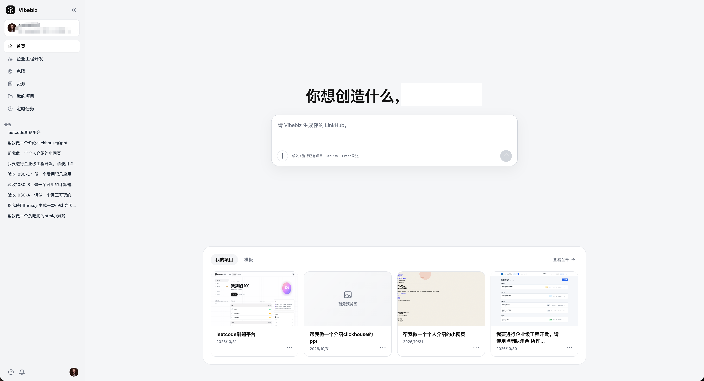 | 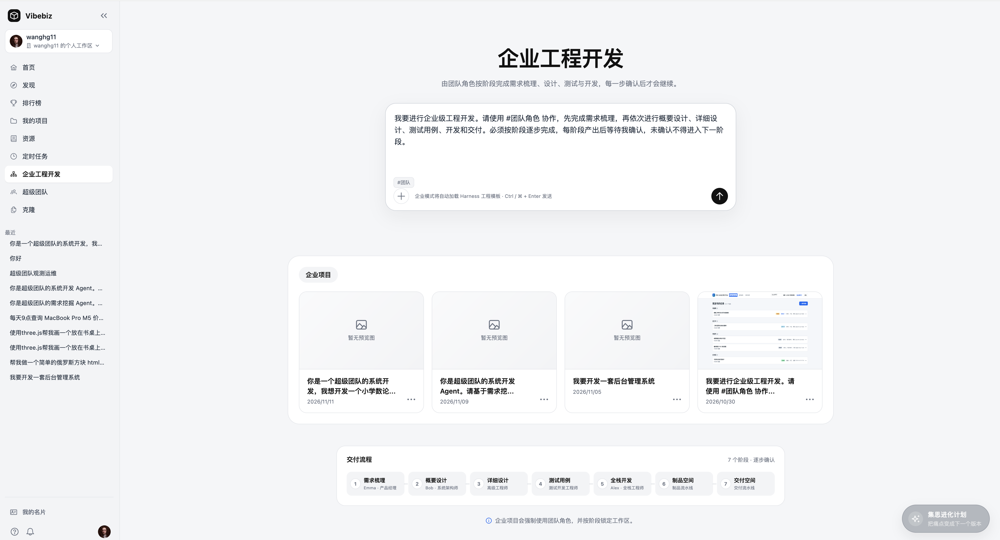 | 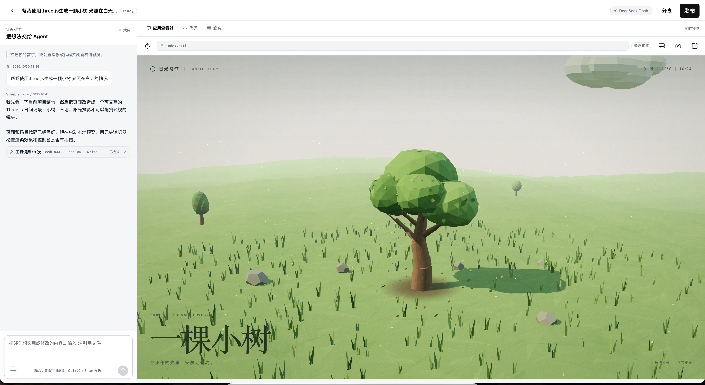 | 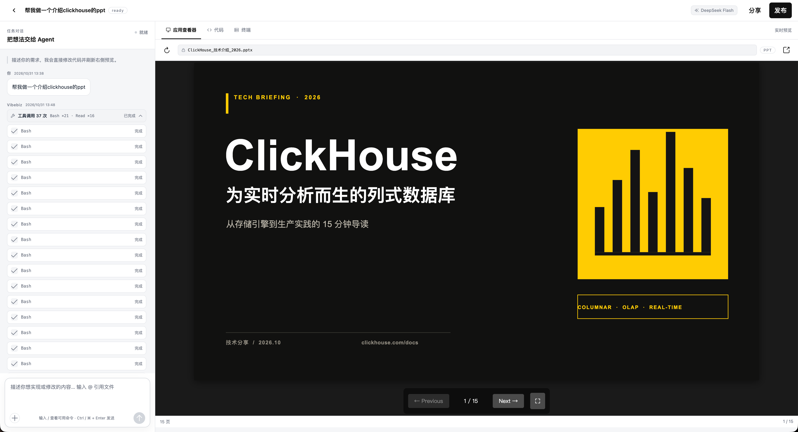 |
| 一句话开始创作 | 7 阶段团队协作 | 可交互 3D 场景 | 可翻页演示文稿 |

| 全栈应用 | 小游戏 | 发现 · 编码伙伴 | 我的名片 |
|:---:|:---:|:---:|:---:|
| 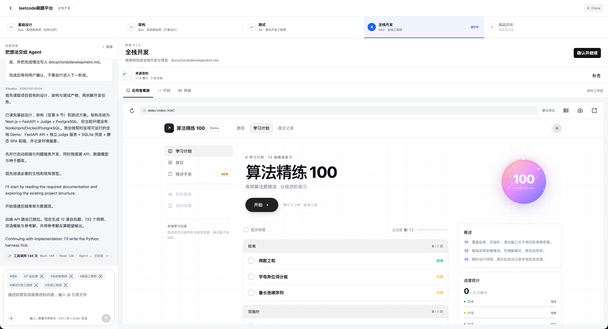 | 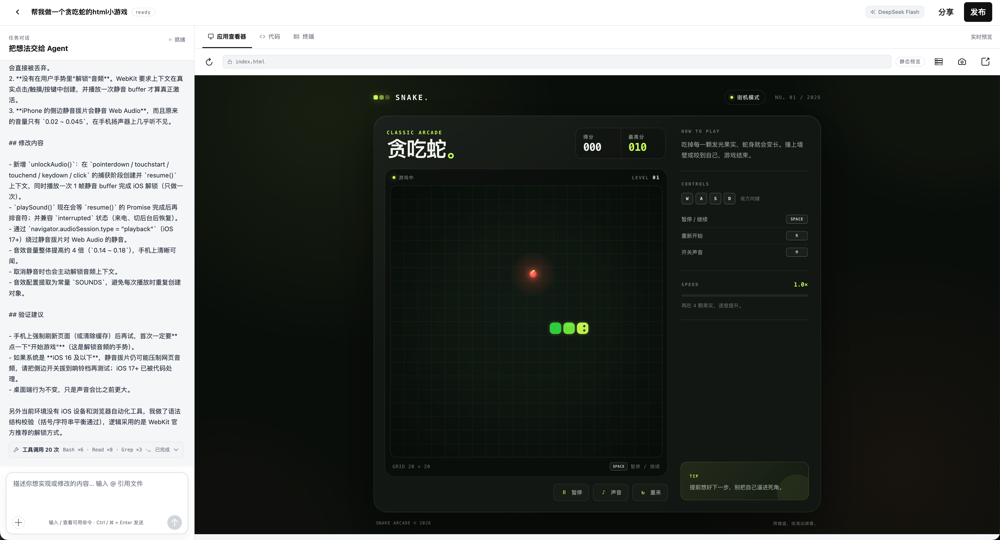 | 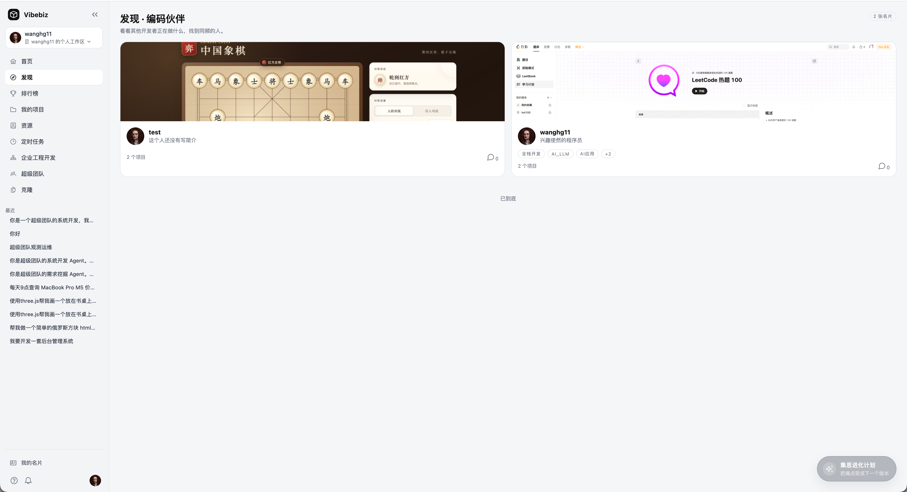 | 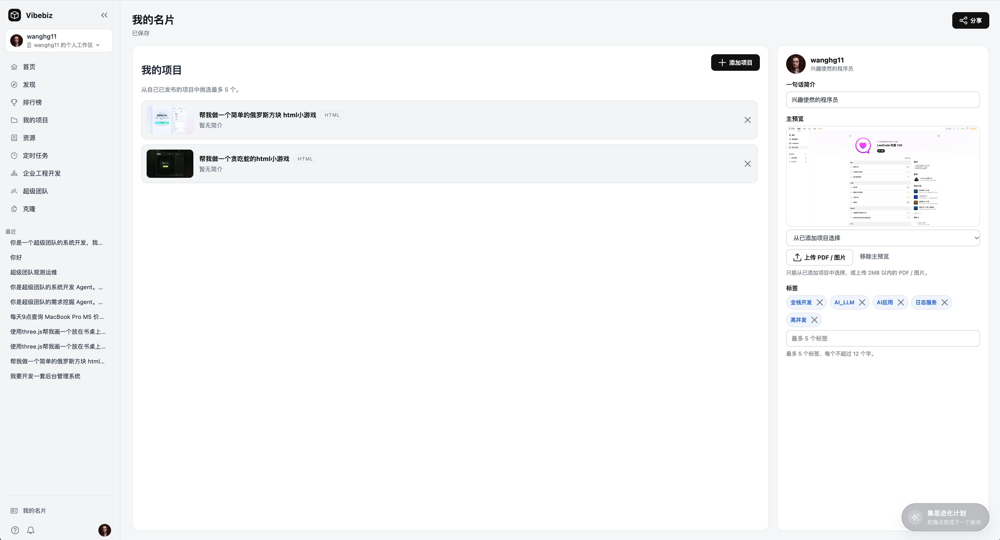 |
| 需求、设计、开发逐阶段落地 | 手机可玩的生成游戏 | 浏览开发者名片 | 个人主页与作品集 |

| 排行榜 | 超级团队 | 集思进化 | 运营后台 |
|:---:|:---:|:---:|:---:|
| 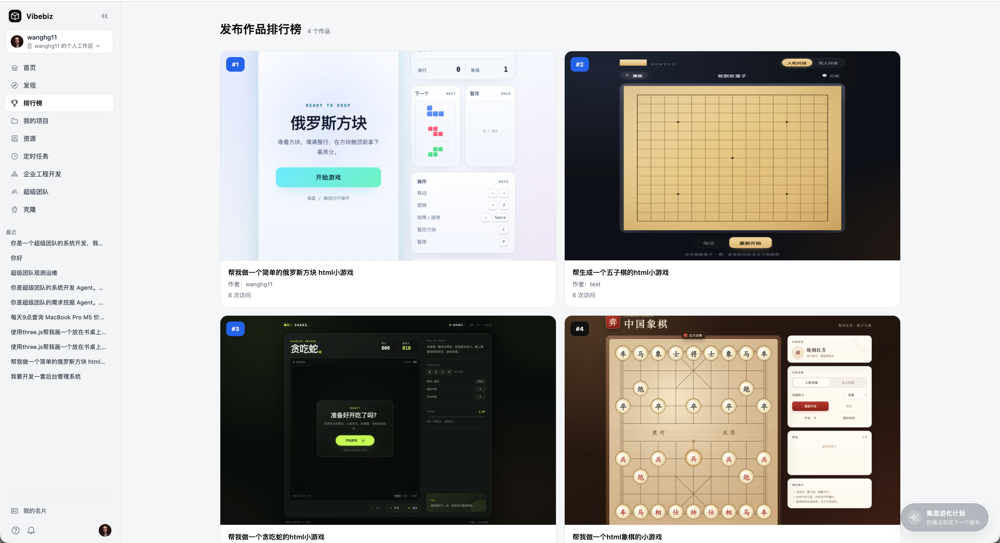 | 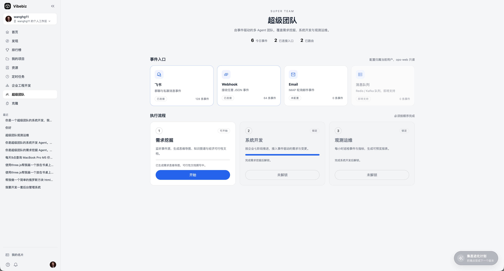 | 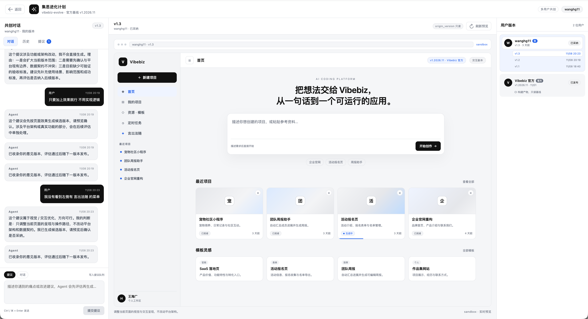 | 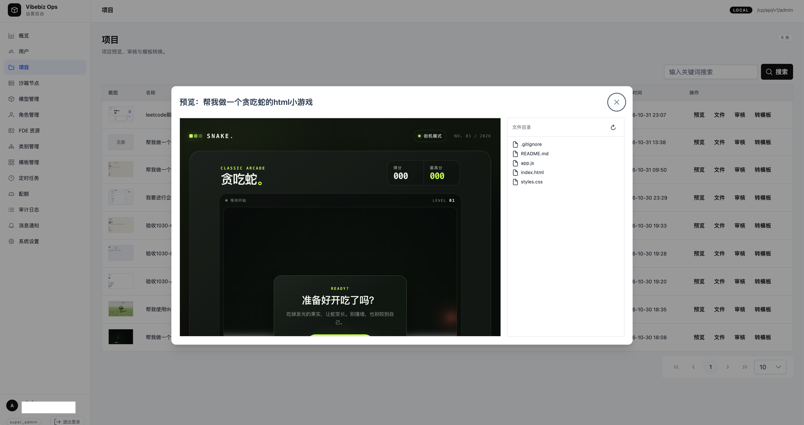 |
| 发布作品排行 | 事件驱动三步流程 | 建议、预览与版本 | 项目预览与审核 |

## 功能说明

### 对话生成与实时预览

编辑器左侧是任务对话，右侧提供「应用查看器 / 代码 / 终端」三个视图。Agent 通过工具调用读写工作区，前端实时展示执行过程；支持停止生成、回看聊天记录、查看执行日志，以及 PPTX、图片、PDF、视频等文件的预览。

### 代码与文件

Monaco 代码视图、文件树、文件读写与版本冲突校验（`baseVersion` 不一致返回 409）、预览入口自定义、项目封面上传。项目资料通过 staging 上传后转入项目，按用途限制：默认单文件 20MB、克隆图片 10MB、克隆文档 / 单测 100MB、项目总量 500MB。

### 克隆应用与网站

创建克隆项目时填写目标名称、描述和 URL，并上传截图、参考文档与单测压缩包。5 个阶段依次为：基础设计、架构、测试、全栈开发、制品空间；测试阶段会安全解压仓库并受控执行 pytest / npm 单测，产出测试报告。

### 企业工程开发

创建企业项目时必须选择团队角色，系统自动展开为产品、架构、高级工程、测试、全栈等子 Agent。7 个阶段依次为：需求梳理、概要设计、详细设计、测试用例、全栈开发、制品空间、交付空间；前 5 个阶段由 Agent 产出固定文档，后端校验产物非空且阶段顺序正确后才允许确认推进。

制品空间按「代码上传 → Jenkins 构建 → Harbor 推送」组织；交付空间支持 K8s、云主机、Argo、FDE 人工四选一。连接配置保存在浏览器本地，FDE 人员由运营后台录入，用户端只读取启用资源。

### 超级团队

把飞书、Webhook、邮箱等事件接入为事件源，经过噪声过滤、语义评估和路由后进入「需求挖掘 → 系统开发 → 观测运维」三步。每一步绑定真实项目或定时任务：需求挖掘生成需求导图与可行性文档，系统开发进入企业七阶段，观测运维创建每小时巡检任务。

> 当前为前端流程原型：事件、步骤与审计状态存浏览器本地，运营后台超级团队页仍使用 mock 数据。

### 集思进化

用户选择自己的 sandbox 版本，对 Vibebiz 提交 bug、视觉或功能建议；Agent 直接修改工作区并可预览，运营在后台查看对话与版本、回复用户，并把通过的方案推进为编码、CI、发布任务。官方版本与用户版本按作者分组展示。

### 个人名片与发现

我的名片支持头像、简介、标签、主预览（图片 / PDF）和已发布项目列表，设置精选内容后生成公开分享链接。发现页滚动加载其他开发者名片，可打开名片或精选项目；项目分享页支持 HTML、图片、PDF、视频、文档等内容类型。

### 发布、分享与排行榜

发布时把项目工作区复制到共享发布目录，生成无需登录的 `/p/{projectId}/` 分享页，手机与局域网均可访问；同一项目再次发布覆盖更新，链接保持不变。分享页统计 PV、曝光与点击，发布作品进入排行榜（候选 200 / 对外 50）。

### 定时任务

用自然语言描述执行内容，sandbox 解析为 daily / weekly / cron 计划；也可手动填写时间、星期与 cron 表达式。任务绑定项目工作区，按计划执行 Agent，支持暂停、恢复、停止，并记录最近运行状态、错误与运行次数。超级团队的观测运维步骤会创建一个每小时任务。

### 渠道包与发布渠道

编辑器内可从 HTML5 源码或引擎成品 zip 生成微信小游戏、抖音小游戏、Steam 桌面渠道包，分析结果给出 A 级直接兼容、B 级需适配层、C 级暂不支持三档，并输出可下载的 zip。发布渠道指引由运营后台维护 Markdown，用户端「设置 → 发布渠道指引」只读查看。

### 项目、模板与协作

多工作区切换、项目归属隔离、成员邀请、文件夹、个人资料与头像、项目封面、模板列表与一键复用。用户端「资源」页按类别浏览模板；运营后台维护父 / 子类别、模板审核与模板文件。

### 技能与模型

编辑器可查看当前项目可用 Skills，来源分为用户、项目、插件、公共；用户技能上传受 `USER_SKILL_UPLOAD_ENABLED` 开关控制。运营后台维护技能、LLM 模型（模型编码、接口地址、密钥与扩展参数）、Agent 角色与头像。

### 通知

设置页配置 Webhook、飞书、企微、钉钉或邮箱，同一用户可配置多个渠道，配置加密入库并可发送测试消息。站内通知通过 WebSocket 实时推送，运营后台可创建、发布、下线与删除通知。

### 运营后台

ops-web 只访问 CP admin API，提供概览、用户、项目、名片、排行榜、集思进化、超级团队、沙箱节点、模型、技能、角色、FDE 资源、类别、模板、发布渠道、定时任务、配额、审计日志、访问日志、消息通知与系统设置。

## 快速开始

环境要求：Go 1.24+、Node.js 20+、Python 3.13+（`uv`）、MySQL 8、Redis 6+。

首次运行前配置本地 hosts：

```text
127.0.0.1 vibebiz-dev.com vibebiz-dev-ops.com
```

初始化并启动：

```bash
make init
make install
make db-create
make db-migrate-up
make dev
```

| 入口 | 地址 |
|---|---|
| Web | http://vibebiz-dev.com:5173 |
| Ops Web | http://vibebiz-dev-ops.com:5174 |
| CP health | http://vibebiz-dev.com:8080/health |
| DP health | http://vibebiz-dev.com:8081/health |
| Sandbox health | http://localhost:8000/health |

测试账号通过 `packages/web/.env` 与 `packages/ops-web/.env` 中的 `VITE_DEMO_IDENTIFIER` / `VITE_DEMO_PASSWORD` 注入；生产环境请设置 `VITE_DEMO_LOGIN=false` 并删除默认账号。

## 常用命令

| 命令 | 说明 |
|---|---|
| `make dev` | 同时启动 sandbox / cp / dp / web / ops-web |
| `make dev-<service>` | 单独启动某一端 |
| `make test` | 四端测试 |
| `make quality` | Go / Python / TypeScript / Vue 质量门禁 |
| `make validate` | 静态校验 + 分层依赖 + 质量门禁 |
| `make build` | CP / DP / web / ops-web 生产构建 |
| `make db-create` / `db-migrate-*` | 创建数据库、迁移、回滚与状态查询 |
| `make docker-build*` / `docker-up` / `docker-down` | 构建与启停 Docker 镜像 |
| `make checkpoint` / `memory-add` | 保存 `.ai` 检查点与经验 |
| `make stop` / `make clean` | 停止本地进程 / 清理构建产物（保留工作区） |

单包入口：`make -C packages/<backend|sandbox|web|ops-web> <target>`。

## 目录结构

```text
packages/
  web/         用户端：首页、标准/克隆/企业编辑器、名片、发现、排行榜、进化、定时任务、超级团队、设置
  ops-web/     运营后台：用户、项目、名片、排行榜、进化、超级团队、沙箱、模型、技能、角色、FDE、模板、通知等
  backend/     Go：cmd/cp、cmd/dp、cmd/migrate，共享 internal 业务模块与 MySQL/Redis/S3 仓储
  sandbox/     Python：workspace、Agent、文件 API、技能、定时任务解析、克隆、预览、心跳
deployment/    Docker Compose、Helm charts 与 nginx 配置
docs/          产品截图、技术设计、规格与实施计划
scripts/       本地开发、质量门禁、校验、harness 工具
templates/     Go / Python / TypeScript / Vue / 文档模板
.ai/           跨会话上下文、规则、记忆、检查点
```

后端 `internal/` 按领域拆分，主要包括：

```text
account auth           登录、会话、工作区与项目鉴权
projectstage harness   企业 7 阶段与 Harness 导入
clone businesscard     克隆项目、个人名片
leaderboard publish    发布、分享、访问/曝光/点击统计与排行榜
evolution scheduledtask 集思进化、定时任务
channelpkg channelguide 渠道包生成与发布渠道指引
resource projecttemplate 项目资料、模板与类别
agentrole role llmmodel 团队角色、Agent 角色、LLM 模型
notification notificationchannel 站内通知与个人通知渠道
sandboxregistry usage usertrace 沙箱注册调度、用量配额、访问日志
```

Sandbox `app/` 分为 `routers` 与 `services`：文件、聊天 SSE、预览、资源、技能、定时任务解析、克隆、租约与日志。

## 数据目录

本地开发（`make dev`）默认把运行时数据写入仓库根目录 `data/`，且不入库；Docker 部署的挂载位置因 compose 而异，以 `deployment/docker/*.yml` 为准。以下为本地开发目录：

```text
data/workspaces/        项目工作区（sandbox 读写；唯一真相源）
data/published/         发布产物，供分享页与 nginx 读取
data/skills/            用户端技能
data/user-trace/        用户访问日志
data/channel-packages/  渠道包产物（微信/抖音/Steam），按项目/渠道归档
```

项目工作区内的 `.chathistory/`、`.resources/`、`.logs/`、`.clone/` 等隐藏目录分别保存聊天历史、项目资料、执行日志与克隆状态，不会出现在普通文件树、预览或发布产物中。

## 测试与质量

```bash
make test       # backend go test + sandbox pytest + web/ops-web vitest
make quality    # gofmt / go vet / ruff / ESLint / 调色板
make validate   # 结构、契约、分层依赖与质量静态校验
```

覆盖重点：CP/DP 路由隔离与鉴权、admin、sandbox 注册与调度、MySQL 仓储、企业阶段状态机、克隆与名片、排行榜、定时任务、通知加密、`/metrics`；sandbox 的路径穿越、版本冲突、SSE、聊天历史、技能与租约；前端的 SSE 分帧、信封解包、路由与导航、阶段状态与表单校验。

## 当前限制与后续方向

- 超级团队为前端流程原型，事件源、步骤与审计状态存浏览器本地，未接后端持久化。
- 企业制品空间 / 交付空间为流程编排与配置演示，连接配置存浏览器，未执行真实构建与部署。
- 集思进化的编码、CI 与发布任务为状态流转，尚未接入真实流水线。
- 发布为静态目录覆盖式发布，不保存版本历史；排行榜统计存 Redis。
- 通知渠道支持配置与测试发送，系统通知尚未按渠道自动投递。
- 预览与主站同 origin、项目跨节点并发写、E2B 沙箱迁移等运行隔离事项仍在推进。

完整待办与验收状态见 [.ai/TODO.md](.ai/TODO.md)。

## 文档

- [技术说明](docs/TECHNICAL.md)：架构、服务职责、常用命令、配置、API、部署与安全限制
- [技术设计](docs/AI-Coding-Platform-技术设计文档.md)
- [业务数据库设计](docs/superpowers/specs/2026-10-28-business-database-design.md)
- [企业工程开发设计](docs/superpowers/specs/2026-10-30-enterprise-engineering-design.md)
- [克隆能力设计](docs/superpowers/specs/2026-10-31-clone-capability-design.md)
- [定时任务设计](docs/superpowers/specs/2026-10-30-scheduled-task-design.md)
- [名片社交设计](docs/superpowers/specs/2026-11-08-business-card-social-design.md)
- [集思进化设计](docs/superpowers/specs/2026-11-08-vibebiz-evolve-design.md)
- [超级团队设计](docs/superpowers/specs/2026-11-09-super-team-design.md)
- [Sandbox 注册中心设计](docs/superpowers/specs/2026-10-29-sandbox-registry-design.md)
- [Helm 部署说明](deployment/helm/README.md)
