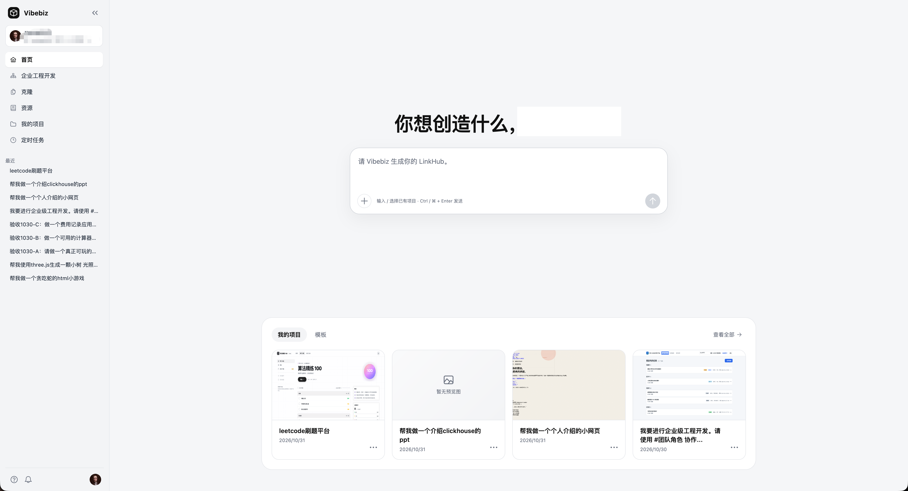
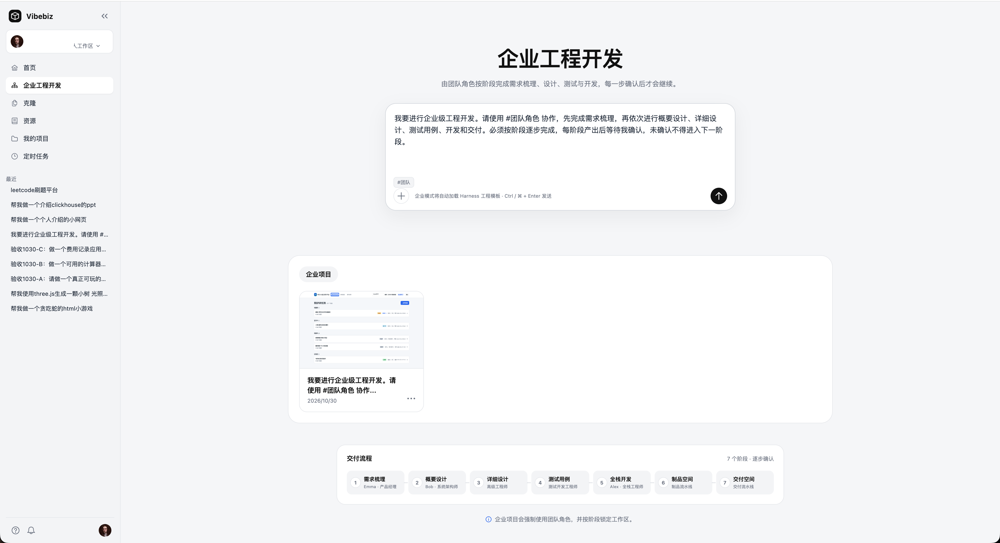
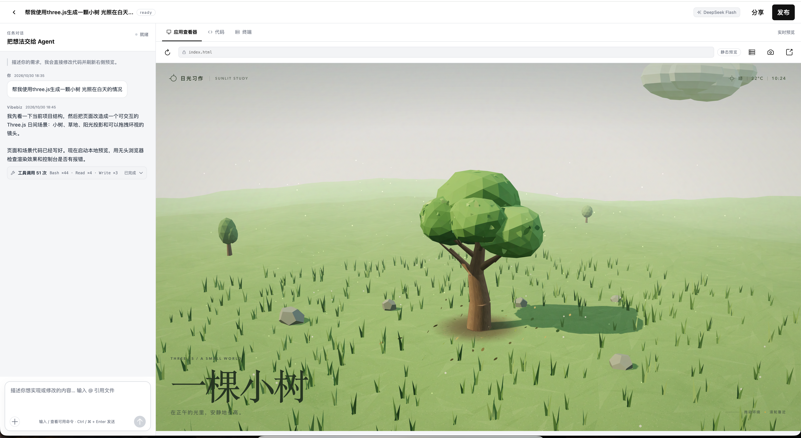
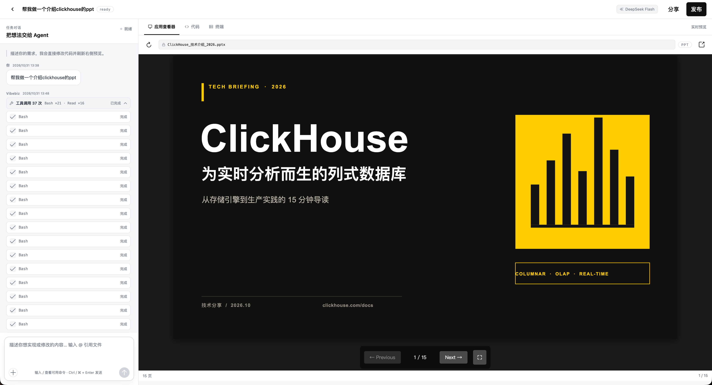
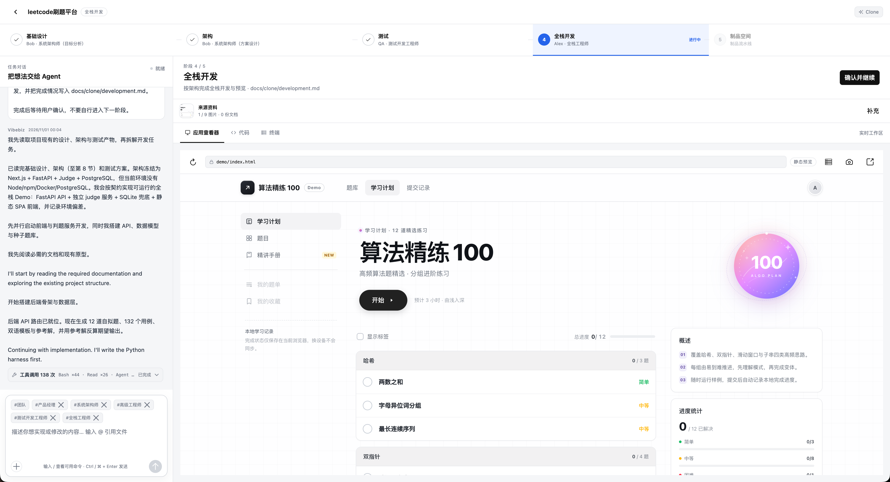
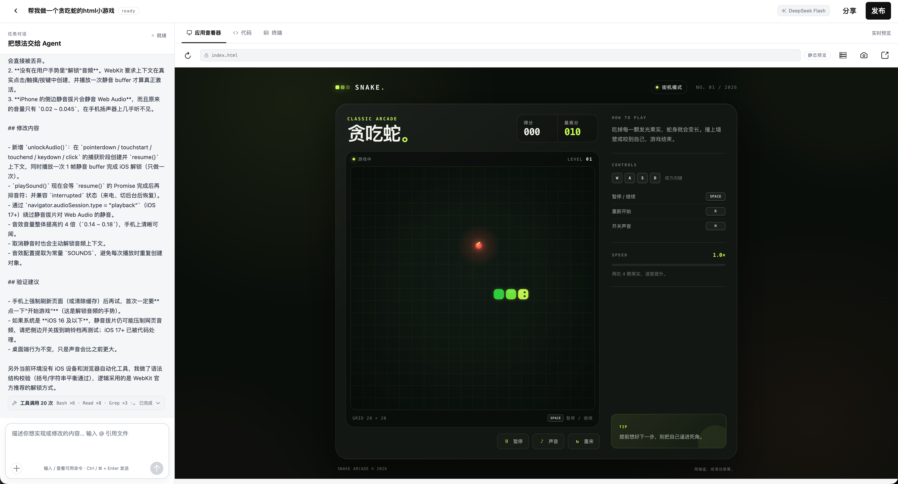
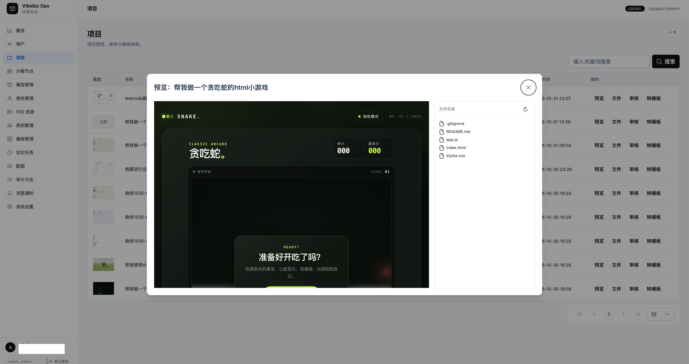

# Vibebiz · AI Coding Platform

一句话描述需求，AI Agent 在隔离工作区中生成网页、小游戏、PPT 或全栈应用，甚至你还可以克隆一个应用或者网站；企业项目则按需求、设计、测试、开发、制品、交付 7 个阶段推进，每一步人工确认后继续。

> 可运行的全栈产品原型，不是生产级 SaaS。技术架构、配置与部署见 [技术说明](docs/TECHNICAL.md)。

## 架构

```text
                       ┌─────────────────────────────────────┐
                       │ web :5173        ops-web :5174       │
                       │ 标准/企业编辑器   运营后台             │
                       └──────────┬───────────────┬──────────┘
                                  │               │
                         /cp/api/v1│               │/cp/api/v1/admin
                                  ▼               ▼
                       ┌─────────────────────────────────────┐
                       │ CP · Go :8080                       │
                       │ 项目 / 企业阶段 / Harness / 鉴权     │
                       │ admin / sandbox 注册                 │
                       └──────┬───────────────┬──────────────┘
                              │               │
                    /dp/api/v1│               │MySQL / Redis
                              ▼               ▼
                       ┌──────────────┐  ┌──────────────────┐
                       │ DP · Go :8081│  │ MySQL 8          │
                       │ 文件 / SSE   │  │ Redis            │
                       │ 日志 / 预览  │  └──────────────────┘
                       └──────┬───────┘
                              │ internal HTTP / SSE
                              ▼
              ┌──────────────────────────────────────────┐
              │ sandbox · Python + FastAPI :8000         │
              │ workspace / Agent / 文件 API / 静态预览   │
              │ 无状态计算，工作区位于共享 NFS/RWX        │
              └──────────────────────────────────────────┘
```

## 功能摘要

- **一句话生成**：描述想法即可生成网页、小游戏、演示文稿、数据可视化和全栈应用。
- **克隆应用与网站**：输入现有应用的 URL 并补充素材，AI 将其复刻为可继续开发的项目。
- **实时预览**：对话式生成，过程实时可见，代码与页面预览同步更新。
- **企业工程开发**：团队角色协作，按 7 个阶段推进，产物校验通过并人工确认后进入下一阶段。
- **项目与协作**：多工作区、成员邀请、项目资料、模板复用、封面与聊天记录回看。
- **一键发布**：把作品发布为手机可访问的公开链接，再次发布覆盖更新。
- **通知渠道**：个人级 Webhook、飞书、企微、钉钉机器人与邮箱配置，支持测试发送。
- **运营后台**：概览、用户、项目、沙箱、配额、审计与通知管理。

## 产品截图

| 首页 | 企业工程开发 | 交互页面（Three.js） | 演示文稿（PPT） |
|:---:|:---:|:---:|:---:|
|  |  |  |  |
| 一句话开始创作 | 7 阶段团队协作 | 可交互 3D 场景 | 可翻页演示文稿 |

| 全栈应用 | 小游戏 | 运营后台 |
|:---:|:---:|:---:|
|  |  |  |
| 需求、设计、开发逐阶段落地 | 手机可玩的生成游戏 | 项目预览与审核 |

## 功能说明

### 对话生成与实时预览

编辑器左侧是任务对话，右侧提供「应用查看器 / 代码 / 终端」三个视图。Agent 通过工具调用读写工作区，前端实时展示执行过程；支持停止生成、回看聊天记录与执行日志。

### 代码与文件

Monaco 代码视图、文件树、文件读写与版本冲突校验（`baseVersion` 不一致返回 409）、预览入口自定义，以及项目资料与封面上传。

### 企业工程开发

创建企业项目时必须选择团队角色，系统自动展开为产品、架构、高级工程、测试、全栈等子 Agent。7 个阶段依次为：需求梳理、概要设计、详细设计、测试用例、全栈开发、制品空间、交付空间；前 5 个阶段由 Agent 产出固定文档，后端校验产物非空且阶段顺序正确后才允许确认推进。

### 项目、模板与协作

多工作区切换、项目归属隔离、成员邀请、个人资料与头像、项目封面、模板列表与一键复用。

### 发布与分享

发布时把项目工作区复制到共享发布目录，生成无需登录的 `/p/{projectId}/` 分享页，手机与局域网均可访问；同一项目再次发布覆盖更新，链接保持不变。

### 通知渠道

在「设置 → 通知渠道」配置 Webhook、飞书、企微、钉钉或邮箱，同一用户可配置多个渠道；配置加密入库，可发送测试消息。

### 运营后台

ops-web 只访问 CP admin API，提供概览、用户、项目、沙箱节点、配额、审计、通知与系统设置。

## 快速开始

环境要求：Go 1.24+、Node.js 20+、Python 3.13+（`uv`）、MySQL 8、Redis 6+。

首次运行前配置本地 hosts：

```text
127.0.0.1 vibebiz-dev.com vibebiz-dev-ops.com
```

初始化并启动：

```bash
make init
make install
make db-create
make db-migrate-up
make dev
```

| 入口 | 地址 |
|---|---|
| Web | http://vibebiz-dev.com:5173 |
| Ops Web | http://vibebiz-dev-ops.com:5174 |
| CP health | http://vibebiz-dev.com:8080/health |
| DP health | http://vibebiz-dev.com:8081/health |
| Sandbox health | http://localhost:8000/health |

测试账号通过 `packages/web/.env` 与 `packages/ops-web/.env` 中的 `VITE_DEMO_IDENTIFIER` / `VITE_DEMO_PASSWORD` 注入；生产环境请设置 `VITE_DEMO_LOGIN=false` 并删除默认账号。

## 文档

- [技术说明](docs/TECHNICAL.md)：架构、服务职责、常用命令、配置、API、部署与安全限制
- [技术设计](docs/AI-Coding-Platform-技术设计文档.md)
- [业务数据库设计](docs/superpowers/specs/2026-10-28-business-database-design.md)
- [企业工程开发设计](docs/superpowers/specs/2026-10-30-enterprise-engineering-design.md)
- [Sandbox 注册中心设计](docs/superpowers/specs/2026-10-29-sandbox-registry-design.md)
- [Helm 部署说明](deployment/helm/README.md)
