# AI 代码生成平台 · 技术设计文档

| 项 | 内容 |
|---|---|
| 文档版本 | v1.2 |
| 状态 | 设计评审稿 |
| 定位 | 面向后端开发工程师的产品级架构设计 |
| 技术选型基调 | Vue3 / Go CP+DP / 容器化 Sandbox / Claude Agent SDK / MySQL 8 |
| 图表规范 | 全部核心流程使用 Mermaid 绘制，随 Markdown 源码一同版本化 |

---

## 目录

- [1. 概述](#1-概述)
- [2. 架构总览](#2-架构总览)
- [3. 核心链路时序](#3-核心链路时序)
- [4. 前端设计](#4-前端设计)
- [5. 并发编辑模型](#5-并发编辑模型)
- [6. 后端 CP / DP 设计](#6-后端-cp--dp-设计)
- [7. 沙箱内部设计](#7-沙箱内部设计)
- [8. Agent SDK 集成要点](#8-agent-sdk-集成要点)
- [9. 数据库设计](#9-数据库设计)
- [10. 安全设计](#10-安全设计)
- [11. 可观测性](#11-可观测性)
- [12. 实施路线](#12-实施路线)
- [13. 设计决策记录](#13-设计决策记录)
- [14. 已知风险](#14-已知风险)
- [15. 架构总结](#15-架构总结)

### 图表索引

| # | 图名 | 类型 | 所在章节 |
|---|---|---|---|
| 图 1 | 整体分层架构 | flowchart | 2.2 |
| 图 2 | 单一真相源与三个投影 | flowchart | 2.3 |
| 图 3 | 一次完整请求时序 | sequenceDiagram | 3.1 |
| 图 4 | 沙箱冷启动时序 | sequenceDiagram | 3.2 |
| 图 5 | 前端组件结构 | flowchart | 4.1 |
| 图 6 | 编辑器两阶段演进 | flowchart | 4.2 |
| 图 7 | 通信通道拓扑 | flowchart | 4.5 |
| 图 8 | 并发写入冲突处理 | sequenceDiagram | 5.2 |
| 图 9 | 提案模式流程 | flowchart | 5.3 |
| 图 10 | 网关职责边界 | flowchart | 6.1 |
| 图 11 | CP / DP 模块结构 | flowchart | 6.2 |
| 图 12 | 沙箱编排状态机 | stateDiagram-v2 | 6.3 |
| 图 13 | 沙箱内进程布局 | flowchart | 7.1 |
| 图 14 | 工作目录结构 | flowchart | 7.4 |
| 图 15 | SDK 权限判定链 | flowchart | 8.2 |
| 图 16 | 会话与版本关系 | flowchart | 8.4 |
| 图 17 | 数据模型 ER 图 | erDiagram | 9 |
| 图 18 | 安全边界总览 | flowchart | 10 |
| 图 19 | 实施路线甘特图 | gantt | 12 |
| 图 20 | 文件打开决策流程 | flowchart | 4.6 |
| 图 21 | 控制面与数据面分离 | flowchart | 4.7 |
| 图 22 | M0 服务拆分（CP / DP / ops-web） | flowchart | 2.4 |

---

## 1. 概述

### 1.1 产品目标

构建一个「对话即开发」的 Web 平台：用户在浏览器里用自然语言描述需求，AI 在隔离沙箱中真实地读写代码、运行命令、启动开发服务器，用户能**实时看到页面变化**，也能**亲手编辑代码**，两边操作同一个工程而不打架。

### 1.2 核心设计命题

本设计要回答的关键问题，不是「前端如何渲染后端代码」，而是：

> **如何让「人」与「AI」两个编辑者，在同一个工程上安全、实时、可回溯地协作？**

### 1.3 设计原则

| 原则 | 含义 |
|---|---|
| 单一真相源 | 工程代码只存在于沙箱卷中，其他一切都是它的投影 |
| CP / DP 保持哑管道 | 控制面与数据面只做转发与调度，不理解业务消息结构 |
| 计算贴近数据 | Agent SDK 运行在沙箱内，与代码同机 |
| 无状态与有状态分离 | 容器可随时销毁，卷必须持久 |
| 安全默认拒绝 | 网络、文件路径、工具权限一律白名单制 |
| 可回溯优先 | 每次 AI 变更都产生一个可 diff、可回滚的提交点 |

---

## 2. 架构总览

### 2.1 一句话架构

> **一个真相源（卷里的代码）+ 三个投影（Monaco 代码视图 / iframe 真 dev server / SSE 消息流）+ 两个哑管道（Go CP / DP）+ 一个贴身 sidecar（Agent SDK）。**

### 2.2 整体分层架构

> 图 1 描述产品化目标分层；M0 已把 Go 网关层拆成 CP 与 DP 两个进程，具体落地见 2.4。

**图 1 · 整体分层架构**

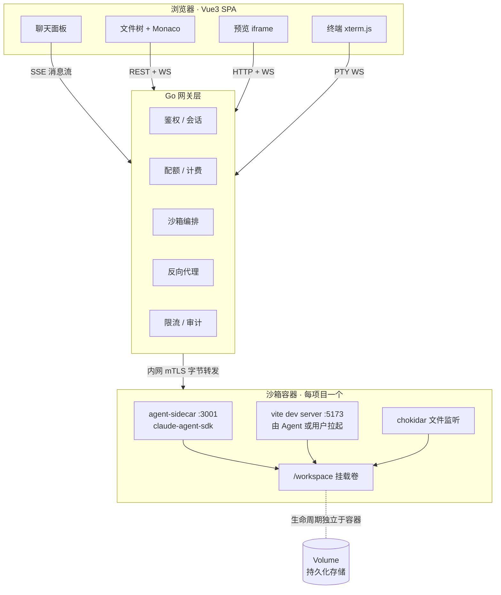

### 2.3 单一真相源与三个投影

用户感知到的「代码、预览、对话」三个界面，看起来是三套系统，本质是**同一份代码的三种投影**。

**图 2 · 单一真相源与三个投影**

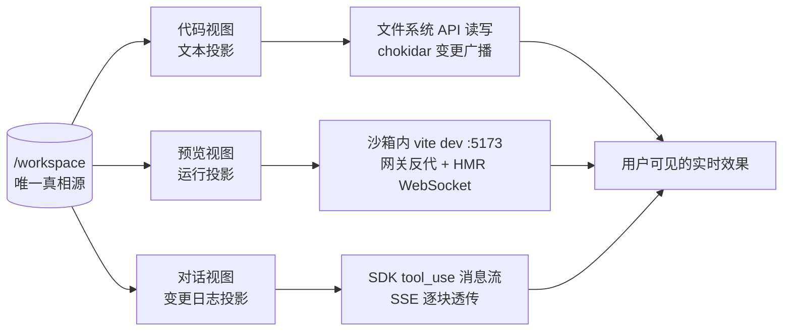

| 视图 | 本质 | 数据来源 | 更新机制 |
|---|---|---|---|
| 代码视图 | 目录树的**文本投影** | 沙箱文件系统 API | 写入 + 文件监听广播 |
| 预览视图 | 目录树的**运行投影** | 沙箱内 `vite dev` :5173 | HMR WebSocket |
| 对话视图 | 目录树的**变更日志投影** | SDK 的 `tool_use` / `assistant` 消息流 | SSE 流式转发 |

> **关键认知**：前端从不持有工程代码的权威副本，它只是显示文件和发送写请求的客户端。AI 改代码后用户看到页面变化，是因为沙箱里真的有一个 dev server 在做热更新——而不是前端把代码「渲染」成了页面。

### 2.4 M0 服务拆分（CP / DP / ops-web）

M0 已把单一 Go 后端拆成两个可独立部署的进程，并新增运营后台；图 1 描述的是产品化目标形态，M0 的落地优先级是先把控制面 / 数据面边界固定下来。

**图 22 · M0 服务拆分（CP / DP / ops-web）**

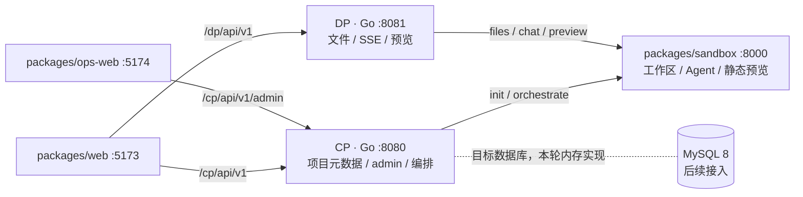

| 服务 | 端口 | 职责 | 明确不做 |
|---|---|---|---|
| CP | 8080 | 项目创建/列表/详情、admin、沙箱初始化编排 | 文件字节、SSE、预览反代 |
| DP | 8081 | 文件树/读写、SSE 透传、预览反代 | admin、项目元数据、项目创建 |
| ops-web | 5174 | 概览、用户、项目、沙箱、配额、审计 | 访问 DP / sandbox；生产裸露公网 |
| sandbox | 8000 | 工作区、文件 API、Agent 循环、静态预览 | 感知 CP/DP 内部实现 |

- 仓库仍是单 Go module：`packages/backend/cmd/cp` 与 `cmd/dp` 共享 `internal/`。
- web 控制请求走 CP，数据请求走 DP；ops-web 只走 CP admin。
- 目标数据库为 MySQL 8；本轮不建表、不引入驱动，CP 与 admin 数据使用内存实现。

---

## 3. 核心链路时序

### 3.1 一次完整请求

**图 3 · 一次完整请求时序**

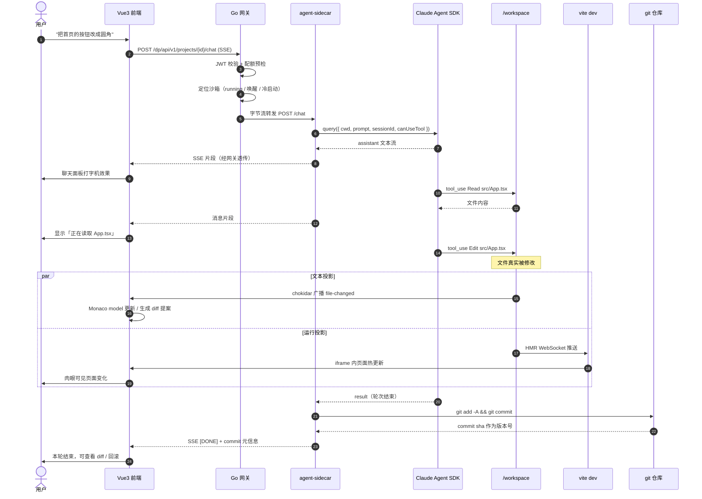

### 3.2 沙箱冷启动

**图 4 · 沙箱冷启动时序**

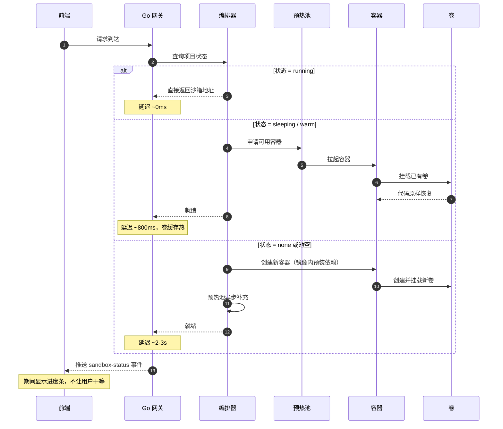

---

## 4. 前端设计

### 4.1 技术栈与组件结构

| 层 | 选型 | 说明 |
|---|---|---|
| 框架 | Vue 3 + TypeScript + Vite | Composition API |
| 状态 | Pinia | 按领域切 store：project / files / chat / sandbox |
| 编辑器内核 | `monaco-editor` | 起步；产品化后换 `@codingame/monaco-vscode-api` |
| 终端 | `xterm.js` + `xterm-addon-fit` | 接 PTY WebSocket |
| Diff | Monaco `DiffEditor` | AI 变更预览 |
| 通信 | `EventSource`（SSE）/ 原生 `WebSocket` | 见 4.5 |

**图 5 · 前端组件结构**

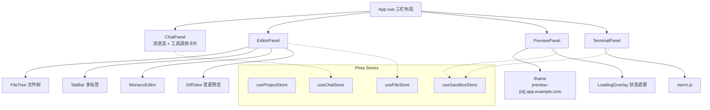

### 4.2 编辑器实现路径

**图 6 · 编辑器两阶段演进**

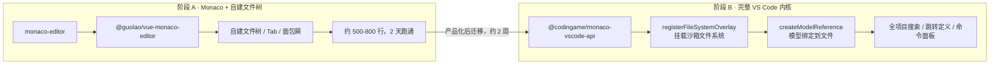

#### 阶段 A：Monaco + 自建文件树 —— 快速验证

适用：MVP、单一语言、不需要跨文件跳转与全项目搜索。

```bash
npm i monaco-editor @guolao/vue-monaco-editor
```

需要自建的部分：文件树、多 Tab、面包屑、保存状态。约 500~800 行。

Monaco 原生就支持「AI 修改可视化」：

```ts
// AI 正在改这个区间 → 打流光装饰
editor.deltaDecorations(oldIds, [{
  range: new monaco.Range(startLine, 1, endLine, 1),
  options: { isWholeLine: true, className: 'ai-typing-line' }
}])

// 把 AI 的增量补丁打进缓冲区（保留 undo 栈，用户可 Ctrl+Z 撤销）
editor.executeEdits('ai', [{ range, text: newText, forceMoveMarkers: true }])
```

`editor.executeEdits()` 是把 AI 改动写入编辑器的**正确入口**——它走 undo 栈，而 `setValue()` 不会。

#### 阶段 B：把完整 VS Code 内核搬进浏览器 —— 产品化

适用：需要全项目搜索（Ctrl+Shift+F）、跳转定义、命令面板、扩展系统。

```bash
npm i @codingame/monaco-vscode-api
npm i vscode@npm:@codingame/monaco-vscode-extension-api
npm i monaco-editor@npm:@codingame/monaco-vscode-editor-api
```

两个决定性 API：

**① `registerFileSystemOverlay`** — 把沙箱文件系统挂成 VS Code 的虚拟文件系统。
自己实现一个 provider：`stat / readFile / writeFile / readDirectory` 走网关到沙箱。挂上之后，VS Code 的搜索、LSP、Git 面板**全都「看见」远端工程**。

**② `createModelReference(fileUri)`** 取代 `monaco.editor.createModel()`。
模型绑定到文件，支持脏标记、`save()`、多引用复用。这是接远端 FS 的前提条件。

Vue3 不是障碍——这套 API 是框架无关的原生 DOM 渲染，整个编辑器面板用 `<div ref>` 挂上去即可。

> **建议**：先 A 后 B。A 约两天跑通；B 约两周工程量，但能省掉后面所有 IDE 功能的重复造轮子。

### 4.3 预览面板

预览是 iframe 加载沙箱内真实运行的 dev server 的反向代理地址：

```html
<iframe
  src="https://preview-{sandboxId}.app.example.com"
  sandbox="allow-scripts allow-same-origin allow-forms"
  referrerpolicy="no-referrer"
/>
```

**必须遵守：**
- 预览域与主站**不同 origin**（不是同域不同路径）——否则用户代码里一行 `parent.document.cookie` 就能窃取主站会话。
- `sandbox` 属性只给 `allow-scripts allow-same-origin allow-forms`，**绝不给** `allow-top-navigation`。
- iframe 常驻不卸载，loading 用遮罩层，避免每次切 Tab 都触发冷编译。

### 4.4 前端状态模型

```ts
// stores/files.ts
interface FileEntry { path: string; type: 'file' | 'dir'; size: number; mtime: number }

interface OpenFile {
  path: string
  model: monaco.editor.ITextModel
  version: number        // 服务端版本号，乐观并发用
  dirty: boolean
  lockedBy: 'ai' | null  // AI 正在编辑则该文件只读
}

interface FileStore {
  tree: FileEntry[]
  openFiles: Map<string, OpenFile>
  activePath: string | null
  proposals: Map<string, EditProposal[]>  // 待用户确认的 AI 变更
}
```

### 4.5 通信契约

**图 7 · 通信通道拓扑**

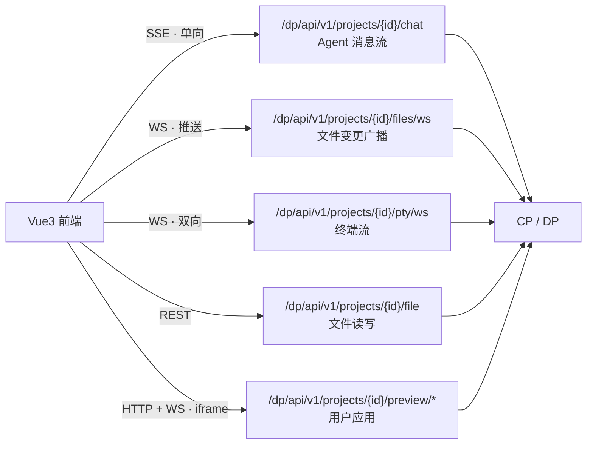

| 通道 | 协议 | 用途 | 备注 |
|---|---|---|---|
| `/dp/api/v1/projects/{id}/chat` | SSE | Agent 消息流（M0 已实现） | 单向，自动重连 |
| `/dp/api/v1/projects/{id}/files/ws` | WebSocket | 文件变更广播（后续） | 服务端推送 |
| `/dp/api/v1/projects/{id}/pty/ws` | WebSocket | 终端双向流（后续） | resize / input / output |
| `/dp/api/v1/projects/{id}/file` | REST | 文件读写 | 带 `baseVersion` |
| `preview-*.app.example.com` | HTTP + WS | 用户应用 | 原样反代 |

统一消息信封：

```jsonc
// 服务端 → 前端（文件变更）
{ "type": "file-changed", "path": "src/App.tsx", "version": 8,
  "origin": "ai", "commit": "a1b2c3d" }

// 服务端 → 前端（Agent 流片段）
{ "type": "agent", "payload": { /* SDK 原始消息，原样透传 */ } }

// 服务端 → 前端（沙箱状态）
{ "type": "sandbox-status", "state": "starting", "progress": 0.4 }
```

### 4.6 大文件、二进制与日志处理

#### 问题定位

Monaco 的 DOM 渲染本来就是虚拟化的——它只渲染视口内的行，所以「十万行文件」不会产生十万个 DOM 节点。真正导致 Chrome 标签页 OOM 崩溃的不是渲染，而是下面四条。

| 杀手 | 机制 | 典型触发 |
|---|---|---|
| 全文进内存 | JS 字符串按字符存储，ASCII 约 1 B/char、含中文 2 B/char；Monaco 另需行偏移数组（Int32Array，4 B/行） | 打开 50MB 文本，光文本与索引就约 150MB |
| 同一内容多份副本 | 网络响应体 + model 文本 + store 里的 `content` + undo 栈快照 + `getValue()` 返回值 | 一顿操作下来并存 5 份 |
| 超长单行 | Blink 文本布局与 Monaco 折行算法在单行极长时急剧退化 | 压缩后的 `bundle.min.js`、单行 JSON |
| 二进制被当文本 | 对任意字节流做 UTF-8 解码，产生海量替换字符 | 用户点开 `.mp4`、`.zip`、`.sqlite` |

单渲染进程的地址空间通常到 2~4GB 量级就会 OOM 崩溃，这个量级决定了下面所有阈值的上限。

#### 图 20 · 文件打开决策流程

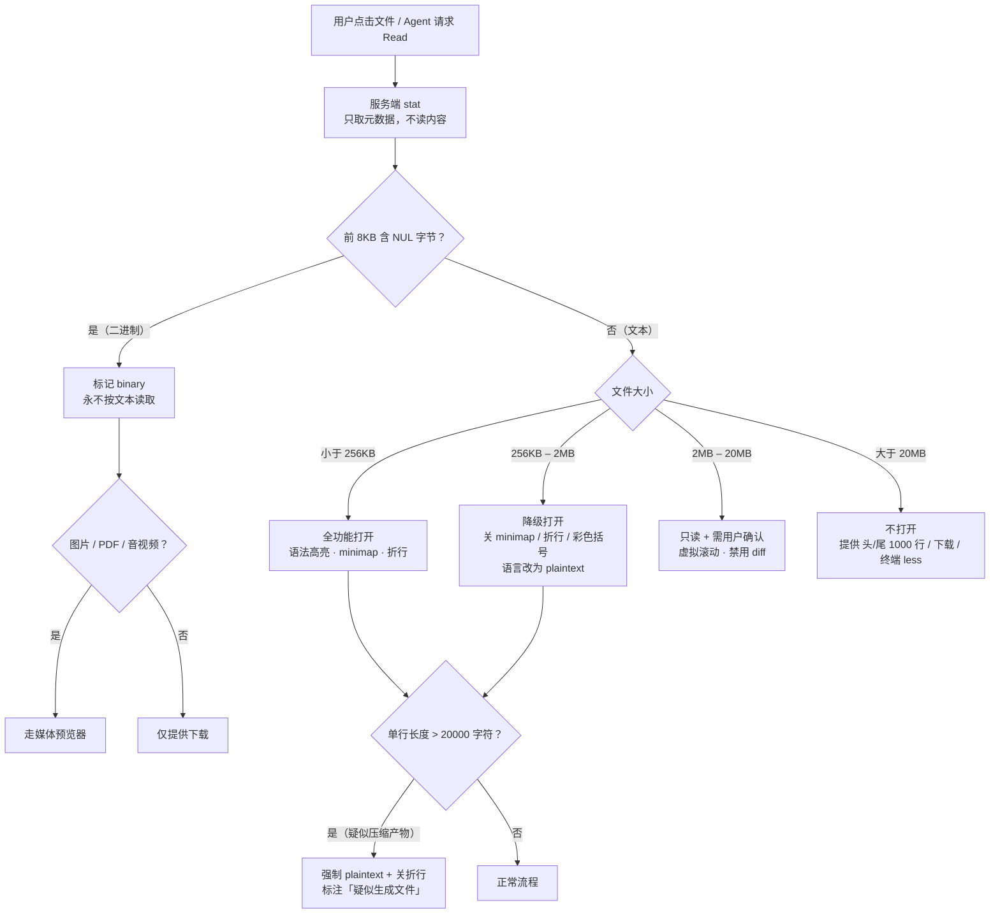

#### 四层防御

**① 服务端闸门（最重要）**

文件 API 一律先返回元数据（`size` / `mtime` / `isBinary` / `maxLineLength` / `lineCount`），前端据此决定要不要、以什么方式拉正文。**绝不无条件把整个文件塞进一个 JSON 响应**——`res.json()` 会在解析时把全文再复制一遍。

**② 传输层**

- 大文件用 `fetch` + `ReadableStream` 分块读取，不经过 `JSON.parse`
- 日志尾部用 HTTP `Range` 请求，只取最后 N 字节
- 二进制一律走 Blob URL，不进文本管道

**③ 编辑器层**

```ts
const large = size > 2 * 1024 * 1024

monaco.editor.create(el, {
  value,
  language: large ? 'plaintext' : detectLanguage(path),
  maxTokenizationLineLength: 20000,   // 超长行不再分词（默认值，显式写出以免被调大）
  largeFileOptimizations: true,       // 默认开启，超内置阈值自动降级
  minimap: { enabled: !large },
  wordWrap: 'off',
  folding: !large,
  bracketPairColorization: { enabled: !large },
  renderLineHighlight: large ? 'none' : 'line',
  scrollBeyondLastLine: false,
})
```

> Monaco 的 `DiffEditor` 走的是序列比对算法，两个大文件对比会直接卡死主线程。**超过 2MB 的文件必须禁用 diff 视图**，改为按行哈希摘要，或提示用户用 git diff。

**④ 前端存储层**

`useFileStore` **不持有文件正文**。正文的唯一载体是 Monaco 的 `ITextModel`，需要时 `model.getValue()` 现取。否则「store 一份 + model 一份 + undo 栈一份」三份并存，内存直接翻三倍。

#### 日志是另一类问题，不该用 Monaco

日志的形态是「追加写 + 体量无上限 + 语法无意义」，用代码编辑器打开本身就是选错了工具。正确做法：

- **环形缓冲 + 虚拟滚动视图**：只保留最后 10,000 行，UI 用虚拟列表或直接 `xterm.js`
- **尾随模式**：WebSocket 流式追加，自动滚到底，等效于 `tail -f`
- **绝不 `model.setValue(整段日志)`**：每次追加都对全文做一次编辑，1GB 日志会瞬间锁死主线程
- 需要看历史时，走服务端 `Range` 请求分页拉取

#### AI 侧同样要拦（这点更隐蔽）

Agent 的 `Read` 工具读一个 300MB 日志，不只是浪费 token——它会因为超长被截断，模型拿到半截内容后自由发挥，产出难以排查的错误结论。所以在 `canUseTool` 里也要加闸：

```ts
if (toolName === 'Read') {
  const st = await fs.stat(input.file_path)
  if (st.size > 5 * 1024 * 1024) {
    return {
      behavior: 'deny',
      message: `文件过大（${(st.size / 1e6).toFixed(1)}MB）。
                请改用 Bash 的 head/tail/grep，或读取指定行区间。`,
    }
  }
}
```

这条同时解决两个问题：省下 token，且引导 Agent 建立「大文件用 grep 而非通读」的习惯——这本身就是更正确的行为模式。

#### 文件树与全项目搜索

同一类坑还有两处：

- 递归列目录**必须**尊重 `.gitignore`，否则 `node_modules` 里五万个文件会一次拉爆
- 全项目搜索要**流式返回 + 硬性上限**（如 500 条），不能在服务端收集齐再一次性返回

#### 兜底

- 每个面板包 ErrorBoundary，单个文件打开失败不拖垮整个应用
- 全局监听 `window.onerror` / `unhandledrejection`，上报时带上「文件路径、大小、操作类型」，便于事后定位
- 超阈值时给用户明确文案（「文件过大，已跳过」）而不是静默失败或白屏

### 4.7 大文件对集群带宽与并发容量的影响

#### 结论先说

**会挤压并发，但先被打爆的不是集群网络，而是网关的出口带宽与 TLS 算力。** 原因是网关是所有流量的**单一收敛点**：无论后端扩容多少沙箱节点，字节都得先经过网关这一跳。这是架构位置问题，不是容量问题——加机器只会线性推高成本，不会消除瓶颈。

#### 定量估算

| 项 | 数值 | 含义 |
|---|---|---|
| 单机 10 Gbps 网卡 | ≈ 1.25 GB/s | 网关节点的物理上限 |
| 一个 50 MB 文件 | ≈ 40 ms | 以满线速传完的时间 |
| 25 个并发 | — | 即可打满一张 10 Gbps 网卡 |
| TLS 1.3 加解密（AES-NI） | ≈ 1~3 GB/s / 核 | 10 Gbps 需 5~10 核**只做加解密** |
| 源码 gzip 压缩率 | 4~6× | 压缩能省带宽，但在网关做很贵：单核约 50 MB/s |

也就是说：**1000 个用户各开一个 2 MB 文件，就是一个 2 GB 的瞬时突发**；而只要有 25 个人同时点开 50 MB 的日志，那台网关的网卡就到顶了，此时与它同机的所有用户——包括正在聊天的——一起变慢。

#### 放大器清单

单看一次读取不吓人，吓人的是这些叠加项：

1. **无缓存的重复读取**。模板文件、`package.json`、`README` 被成千上万人反复拉取，每次都完整回源。
2. **预览流量比文件流量更大**。一次页面加载是几十个静态资源 + 若干 HMR 消息，如果它也走网关，量级是文件读取的 10 倍以上。
3. **切 Tab / 重连即重拉**。前端没有内存缓存，用户来回切文件就是反复请求。
4. **`git diff` 与全项目搜索**。diff 会输出完整文件内容，搜索可能返回上万条命中。
5. **文件监听广播的扇出**。一次 Agent 改动推给 N 个在线标签页，N 越大扇出越大（单条很小，但数量级高）。
6. **跨节点回流**。网关节点与沙箱节点不在同机时，字节还要走一层脊交换机；多副本场景再乘一次。

#### 核心解法：控制面与数据面分离

这是唯一的结构性解法。原则一句话：

> **网关只处理「问」和「许可」，不搬运「货」。**

**图 21 · 控制面与数据面分离**

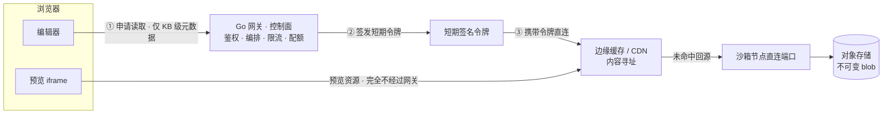

对比传统做法：

| | 全流量过网关 | 控制面/数据面分离 |
|---|---|---|
| 网关承载 | 每字节都过 | 只有授权信令 |
| 扩容效果 | 线性推高成本 | 数据面随 CDN/节点自然分摊 |
| 大文件影响面 | 拖慢同机所有用户 | 只影响该用户自己的连接 |
| 故障域 | 网关一抖，全站受影响 | 数据面单点失败可重试 |

#### 落地措施（按优先级）

**① 直连签名 URL —— 收益最大，必须做**

网关只返回一个带 HMAC 签名、60 秒有效、绑定 `{userId, path, range}` 的 URL，浏览器拿它直接向边缘或沙箱节点取字节。网关完全退出字节路径。

```go
// 控制面仅返回信令
type FileTicket struct {
    URL       string    // 指向 edge 或 sandbox 节点
    ExpiresAt time.Time
    ETag      string
    Size      int64
    IsBinary  bool
    MaxLine   int
}
```

**② 内容寻址 + 边缘缓存**

文件按 `sha256(content)` 存为不可变 blob。同一模板的 `package.json` 在所有用户间共享同一个 key，命中率极高。代码文件变更频率低，缓存 TTL 可以给得很长（有 `file-changed` 事件做主动失效）。

**③ Range 请求 + 窗口化读取**

配合 4.6 的分级降级：只读窗口化文件只拉可见区间；日志尾部只拉最后 N 字节。**永远不要为了显示 40 行去拉 50 MB。**

**④ singleflight 合并回源**

同一 `sha` 的并发回源请求在边缘侧合并成一次，其余等待同一个结果。模板类文件天然受益。

**⑤ 压缩放在数据面，不在网关**

zstd/gzip 在沙箱侧做一次并缓存结果，边缘直接发压缩后的字节。网关做压缩等于把 CPU 也一起绑死。

**⑥ 字节级配额，而不只是 QPS**

按 `bytes/分钟/用户` 计，并区分「控制面请求数」和「数据面字节数」两套配额。只限 QPS 的话，一个用户点开三个 50 MB 文件就能自己吃掉一条链路，而请求数只有 3。

**⑦ 拓扑亲和**

沙箱调度时优先落到离用户边缘节点近的物理位置；网关与数据面节点同机架，减少脊交换流量。

**⑧ 预览流量同样绕开网关**

iframe 的资源加载、HMR WebSocket 走独立的边缘通道，不要经过控制面网关。这一条常被忽略，但它的体量比文件读取大一个数量级。

#### 如何验收

加一条硬指标：**网关在字节路径上的流量占比 < 5%**。用这个数盯着，架构就不会悄悄退化回「全流量过网关」。

---

## 5. 并发编辑模型

### 5.1 明确不做的事

**不做 OT / CRDT**。那是实时多人协作的解法，成本远高于收益。本场景是「人机交替操作」，不是「多人同时输入」。

### 5.2 模型：版本号乐观并发 + 文件级读锁

**图 8 · 并发写入冲突处理**

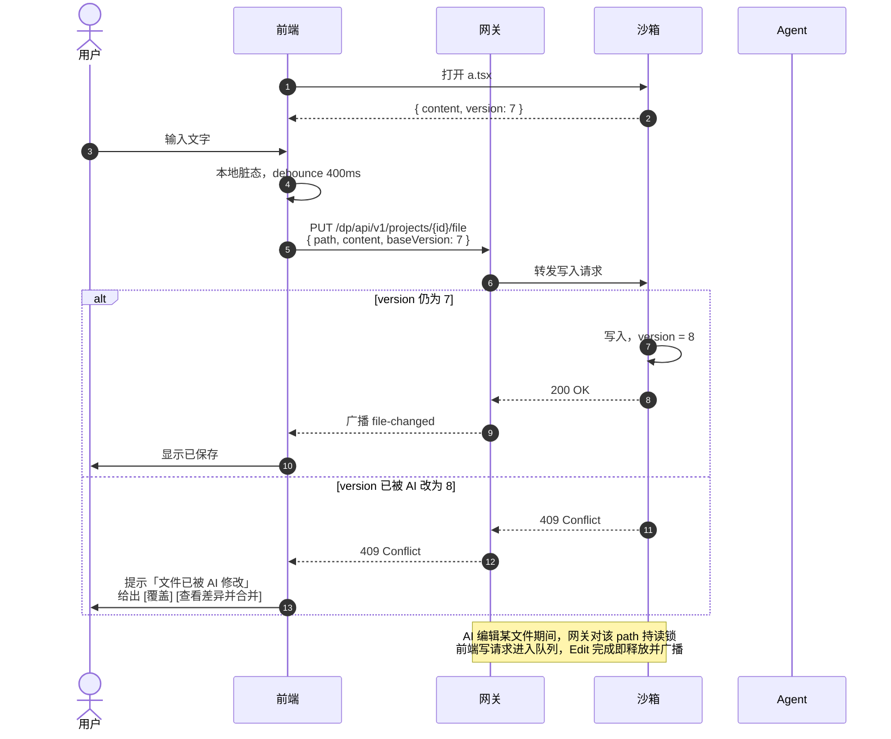

### 5.3 更优解：提案模式

**图 9 · 提案模式流程**

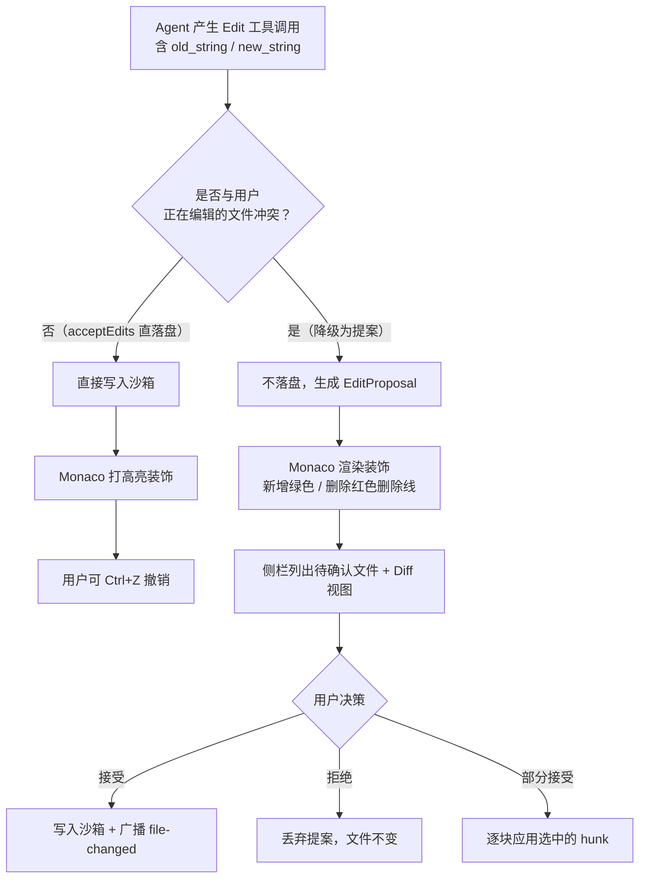

收益：
- 用户全程有控制感，不会被 AI 悄悄改掉
- 天然得到「这次改了什么」的可视化
- 与 git commit 形成清晰的对应关系

代价：每次改动多一次往返。

**折中方案**：`acceptEdits` 模式下直接落盘 + 编辑器内打高亮装饰 + 保留 Ctrl+Z；仅在 keydown 冲突（用户正在该文件敲字）时降级为提案模式。

### 5.4 冲突策略对比

| 策略 | 复杂度 | 适用 |
|---|---|---|
| 文件级锁 | 低 | 起步可用 |
| 版本号乐观并发 | 低 | 默认推荐 |
| 提案模式（人工确认） | 中 | 默认推荐（体验最好） |
| 行级 OT/CRDT | 高 | 不做 |

---

## 6. 后端 CP / DP 设计

> M0 已把原单一 Go 网关拆为 CP（控制面）与 DP（数据面）。下文“网关”泛指控制与转发职责；字节路径由 DP 承担，CP 退出字节路径。

### 6.1 职责边界

**图 10 · 网关职责边界**

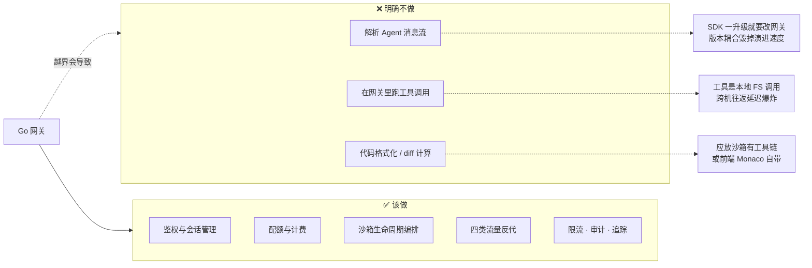

### 6.2 模块划分

**图 11 · CP / DP 模块结构**

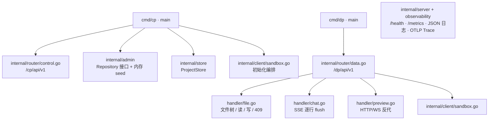

### 6.3 沙箱编排状态机

**图 12 · 沙箱编排状态机**

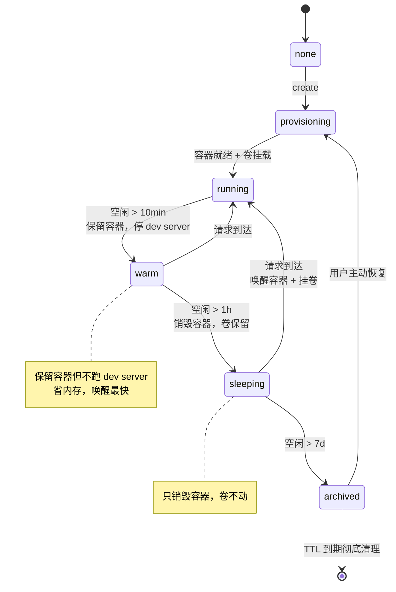

关键点：
- `sleeping` 只销毁容器，**卷不动**
- `warm` 保留容器但不跑 dev server，省内存
- 回收者按 `last_active_at` 做分层淘汰：先 warm→sleeping，7 天无活动才 archived

### 6.4 反向代理要点

```go
// 预览：必须透传 Upgrade，否则 HMR 静默失效
proxy := httputil.NewSingleHostReverseProxy(target)
proxy.Transport = &http.Transport{
    DisableCompression: true,      // 关闭压缩，避免 SSE 缓冲
    ResponseHeaderTimeout: 0,
}
proxy.FlushInterval = -1  // SSE 立即 flush，关键
```

三个必须显式处理的地方：
1. `Connection: Upgrade` / `Upgrade: websocket` 原样透传
2. `FlushInterval = -1` 否则 SSE 会攒批，聊天变成「一次性蹦出来」
3. 改写 `Host` 与 `X-Forwarded-*`，否则 vite 的 HMR 客户端地址算错

> Go 的 WebSocket 长连接 + SSE + 优雅重启不掉线，坑不少。建议直接用 `httputil.ReverseProxy` 的升级支持或 `coder/websocket`，不要自己写帧解析。

---

## 7. 沙箱内部设计

### 7.1 进程布局

**图 13 · 沙箱内进程布局**

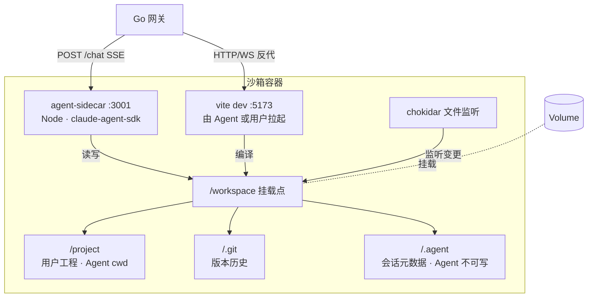

### 7.2 为什么 SDK 必须跑在沙箱里

Agent SDK 的 `Read / Write / Edit / Glob / Grep / Bash` **全部是本地文件系统调用**。若 SDK 放在网关侧，每次工具调用都变成一次跨机往返——一个中等改动要几十次工具调用，延迟会爆炸。

### 7.3 sidecar 接口（极简）

```
POST /chat     (SSE)  { sessionId, message }  → 流式返回 SDK 消息
POST /abort           { sessionId }           → 中断当前轮次
GET  /health                          → { ok, cwd, tools }
```

网关对它**完全透明**，只转发字节。

### 7.4 目录约定

**图 14 · 工作目录结构**

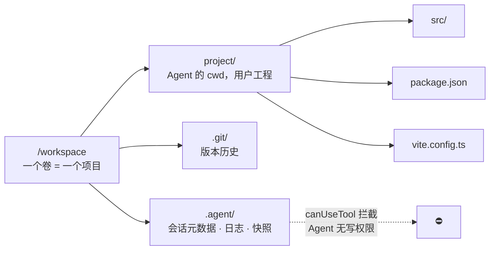

**三个修正（相对原始设计）：**

1. **一个卷对一个项目**，卷名带 `{uid}/{pid}` 前缀用于归属与计费查询。不要在同一卷内做 `users/{uid}/projects/{pid}` 的嵌套虚拟化——容器销毁重建时只需挂回同名卷；共享卷则要处理「删容器时别人项目还在」的引用计数问题。

2. **沙箱与卷生命周期分离。** 容器无状态、可随时销毁、可从预热池复用；卷有状态、持久。用户三天不来，容器回收，代码在卷里毫发无损；用户回来，拉冷容器挂卷，`npm ci` 命中缓存，两秒就绪。**若把代码写在容器里，休眠即丢数据，这是灾难。**

3. **`.agent/` 必须在 Agent 的写权限之外**，否则 Agent 可以篡改自己的会话状态或绕过日志。

---

## 8. Agent SDK 集成要点

> 以下为工程实践经验，部分与公开文档表述不同，以实际 API 行为为准。

### 8.1 基础调用

```ts
import { query } from '@anthropic-ai/claude-agent-sdk'

const q = query({
  prompt: userMessage,
  options: {
    cwd: '/workspace/project',        // 注意：是 cwd，不是 workingDirectory
    settingSources: [],               // 关键：不读工程的 .claude/settings.json
    permissionMode: 'default',
    canUseTool,
  },
})
for await (const msg of q) { /* 推给网关 → 浏览器 */ }
```

### 8.2 权限链（最易踩的坑）

**图 15 · SDK 权限判定链**

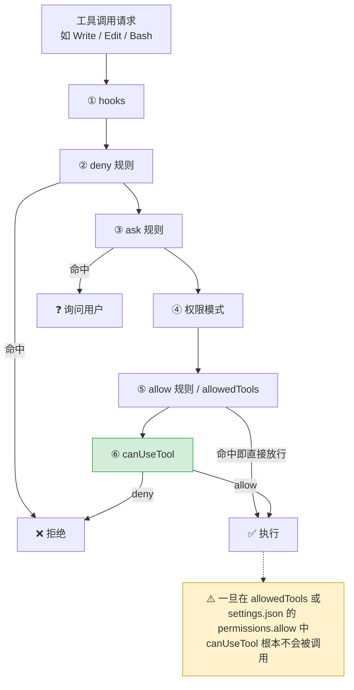

**含义**：只要工具出现在 `allowedTools` 或工程的 `.claude/settings.json` 的 `permissions.allow` 里，`canUseTool` **根本不会被调用**。

> 如果你把 `canUseTool` 当作「防止 Agent 写出 /workspace」的安全边界，同时又配了 `allowedTools: ['Write']`，那这道墙是**假墙**。

多租户平台上的正确配置：

```ts
const canUseTool = async (toolName, input) => {
  if (!ALLOWED_TOOLS.has(toolName)) {
    return { behavior: 'deny', message: '工具未授权' }
  }
  const raw = input.file_path ?? input.path
  if (raw) {
    // 必须 realpath：字符串 startsWith 挡不住 ../.. 和软链接
    const real = await fs.realpath(path.resolve(raw)).catch(() => '')
    if (!real.startsWith(PROJECT_ROOT + path.sep)) {
      return { behavior: 'deny', message: '路径越界' }
    }
  }
  return { behavior: 'allow', updatedInput: input }
}
```

配置：

```ts
settingSources: [],                    // 不加载工程级配置（防注入绕过）
allowedTools: [],                      // 不预批准任何工具
disallowedTools: ['Bash'],             // 或按需只给 Read/Glob/Grep
canUseTool,
```

`bypassPermissions` 必须配对 `allowDangerouslySkipPermissions: true` 才能启动，**生产环境禁用**。顺带一提：在 Linux 上以 root 运行时 SDK 会直接拒绝 `bypassPermissions`——这是官方在替你把一道关。

### 8.3 流式 prompt 的已知缺陷

用 `AsyncIterable` 作为 prompt 且启用了 `canUseTool` / hooks / MCP 时，SDK 会在**首个 `result` 到达时就 `endInput()`**。若此时模型仍在等后台子 agent，子 agent 的每次工具调用都会报：

```
Tool permission request failed: Error: Stream closed
```

而且**不抛异常、不写日志**，最终表现成模型自己编一段「权限错误」讲给用户听，极难排查。

**规避**：保持 prompt 生成器存活，直到满足下列条件再 `return`：
- 没有未闭合的 `tool_use`（每个 `tool_use` 都有对应 `tool_result`）
- 没有 pending 的后台任务

简单单轮场景行为不变。

### 8.4 会话与版本

**图 16 · 会话与版本关系**

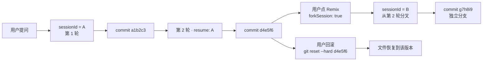

| 能力 | 实现 |
|---|---|
| 继续对话 | 存 `sessionId` 到库，下次 `resume: sessionId` |
| 分支对话（Remix） | `forkSession: true`，得到新 sessionId |
| 版本 / 回滚 | 每轮结束后自动 `git commit` |

**强烈建议先做「每轮自动 git commit」。** 你不需要自建快照系统：commit sha 即版本号，「查看这轮改了什么」是 `git diff`，「回滚」是 `git reset`，「Remix」是 `git branch`——三件套凭空出现，且完全可审计。

### 8.5 sidecar 参考实现骨架

```ts
// sidecar.ts
import { query } from '@anthropic-ai/claude-agent-sdk'
import express from 'express'
import { execFile } from 'node:child_process'

const app = express()
const PROJECT_ROOT = '/workspace/project'

app.post('/chat', async (req, res) => {
  res.setHeader('Content-Type', 'text/event-stream')
  res.setHeader('Cache-Control', 'no-cache')
  res.setHeader('X-Accel-Buffering', 'no')

  const { sessionId, message } = req.body
  const sdk = query({
    prompt: message,
    options: {
      cwd: PROJECT_ROOT,
      ...(sessionId ? { resume: sessionId } : {}),
      settingSources: [],
      allowedTools: [],
      disallowedTools: ['Bash'],
      canUseTool,
    },
  })

  let openToolUses = 0
  for await (const msg of sdk) {
    if (msg.type === 'assistant') {
      for (const block of msg.message.content) {
        if (block.type === 'tool_use') openToolUses++
      }
    }
    if (msg.type === 'user') {
      for (const block of msg.message.content ?? []) {
        if (block?.type === 'tool_result') openToolUses = Math.max(0, openToolUses - 1)
      }
    }
    res.write(`data: ${JSON.stringify(msg)}\n\n`)
  }

  // 轮次结束 → 自动提交，产生版本号
  await execFile('git', ['-C', PROJECT_ROOT, 'add', '-A'])
  await execFile('git', ['-C', PROJECT_ROOT, 'commit', '-m', `turn: ${message.slice(0, 60)}`])

  res.write('data: [DONE]\n\n')
  res.end()
})
```

---

## 9. 数据库设计

> **目标数据库：MySQL 8。** 本轮 M0 不引入驱动、迁移或表结构；CP 项目元数据与 admin 数据均为内存实现。下图是早期逻辑模型，保留用于理解边界；实际业务表 DDL、索引、种子数据与迁移顺序见 [`docs/superpowers/specs/2026-10-28-business-database-design.md`](superpowers/specs/2026-10-28-business-database-design.md)。

**图 17 · 数据模型 ER 图**

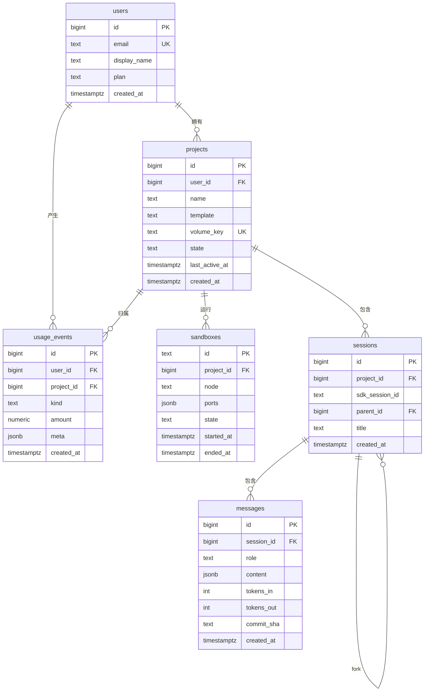

核心 DDL：

```sql
-- 用户（复用平台账号体系，不自建登录）
CREATE TABLE users (
  id            BIGSERIAL PRIMARY KEY,
  email         CITEXT UNIQUE NOT NULL,
  display_name  TEXT,
  plan          TEXT NOT NULL DEFAULT 'free',   -- free | pro | max
  created_at    TIMESTAMPTZ NOT NULL DEFAULT now()
);

-- 项目
CREATE TABLE projects (
  id             BIGSERIAL PRIMARY KEY,
  user_id        BIGINT NOT NULL REFERENCES users(id) ON DELETE CASCADE,
  name           TEXT NOT NULL,
  template       TEXT NOT NULL,                 -- vite-react | vue | html ...
  volume_key     TEXT NOT NULL UNIQUE,          -- 卷标识，形如 u12/p34
  state          TEXT NOT NULL DEFAULT 'none',  -- none|provisioning|running|warm|sleeping|archived
  last_active_at TIMESTAMPTZ NOT NULL DEFAULT now(),
  created_at     TIMESTAMPTZ NOT NULL DEFAULT now()
);
CREATE INDEX ON projects (user_id, last_active_at DESC);

-- 沙箱实例（一项目可能存在历史多条，只有一条 active）
CREATE TABLE sandboxes (
  id         TEXT PRIMARY KEY,                  -- 容器 id / 托管沙箱 id
  project_id BIGINT NOT NULL REFERENCES projects(id) ON DELETE CASCADE,
  node       TEXT,                              -- 所在物理节点
  ports      JSONB NOT NULL DEFAULT '{}',       -- {"preview":5173,"agent":3001}
  state      TEXT NOT NULL,
  started_at TIMESTAMPTZ NOT NULL DEFAULT now(),
  ended_at   TIMESTAMPTZ
);
CREATE UNIQUE INDEX ON sandboxes (project_id) WHERE ended_at IS NULL;

-- 会话（对应 SDK session）
CREATE TABLE sessions (
  id             BIGSERIAL PRIMARY KEY,
  project_id     BIGINT NOT NULL REFERENCES projects(id) ON DELETE CASCADE,
  sdk_session_id TEXT,                          -- SDK 返回的 sessionId
  parent_id      BIGINT REFERENCES sessions(id),-- fork 来源（Remix）
  title          TEXT,
  created_at     TIMESTAMPTZ NOT NULL DEFAULT now()
);

-- 消息（审计 + 重放，逻辑上可从 SDK 流重建）
CREATE TABLE messages (
  id         BIGSERIAL PRIMARY KEY,
  session_id BIGINT NOT NULL REFERENCES sessions(id) ON DELETE CASCADE,
  role       TEXT NOT NULL,                     -- user | assistant | tool
  content    JSONB NOT NULL,
  tokens_in  INT DEFAULT 0,
  tokens_out INT DEFAULT 0,
  commit_sha TEXT,                              -- 本轮产生的版本号
  created_at TIMESTAMPTZ NOT NULL DEFAULT now()
);
CREATE INDEX ON messages (session_id, created_at);

-- 用量（配额与计费）
CREATE TABLE usage_events (
  id         BIGSERIAL PRIMARY KEY,
  user_id    BIGINT NOT NULL REFERENCES users(id),
  project_id BIGINT REFERENCES projects(id),
  kind       TEXT NOT NULL,                     -- llm | sandbox_minute | storage
  amount     NUMERIC(14,6) NOT NULL,
  meta       JSONB NOT NULL DEFAULT '{}',
  created_at TIMESTAMPTZ NOT NULL DEFAULT now()
);
CREATE INDEX ON usage_events (user_id, created_at DESC);
```

---

## 10. 安全设计

**图 18 · 安全边界总览**

```mermaid
flowchart TB
    subgraph L1["① 浏览器层"]
        B1["预览 iframe<br/>独立 origin + sandbox 白名单"]
        B2["不发主站 Cookie<br/>referrerpolicy=no-referrer"]
    end

    subgraph L2["② 网关层"]
        G1["JWT 校验 + RBAC"]
        G2["短期 scoped token<br/>供文件 / 终端 API"]
        G3["限流 + trace-id 审计"]
    end

    subgraph L3["③ 沙箱层"]
        S1["默认断网<br/>出网白名单代理"]
        S2["禁内网网段<br/>禁 169.254.169.254"]
        S3["非 root + seccomp<br/>只读基础镜像"]
        S4["CPU / 内存 / 磁盘 / PID 限额"]
    end

    subgraph L4["④ Agent 层"]
        A1["settingSources: []<br/>不加载工程级 settings"]
        A2["allowedTools: []<br/>不预批准任何工具"]
        A3["canUseTool 内 realpath<br/>再比对前缀"]
        A4["禁写 .agent/<br/>防篡改会话状态"]
    end

    subgraph L5["⑤ 密钥层"]
        K1["模型密钥仅网关持有"]
        K2["不进用户工程"]
        K3["不进浏览器"]
    end

    L1 --> L2 --> L3 --> L4 --> L5
```

| 面 | 措施 |
|---|---|
| **预览隔离** | 独立子域（不同 origin）；iframe `sandbox` 白名单；`referrerpolicy=no-referrer` |
| **沙箱出网** | 默认断网；需要时走白名单代理（禁内网网段、禁云 metadata `169.254.169.254`） |
| **文件越界** | `canUseTool` 内 **`realpath` 后比对前缀**；字符串 `startsWith` 挡不住 `../` 与软链接 |
| **会话劫持** | 预览域不发主站 Cookie；文件/终端 API 用短期 scoped token |
| **权限绕过** | `settingSources: []` + `allowedTools: []`，所有工具走 `canUseTool` |
| **资源滥用** | 单容器 CPU/内存/磁盘/PID 限额；单用户并发容器数上限 |
| **密钥泄露** | 模型密钥仅网关持有，sidecar 通过受限凭证访问；不进用户工程、不进浏览器 |
| **审计** | 每次工具调用、每轮对话、每次文件写入落 `audit_log`，带 trace-id |
| **代码注入** | Agent 不可写 `.agent/` 与会话元数据；`.claude/settings.json` 一律不加载 |

---

## 11. 可观测性

### 11.1 M0 范围与实现

| 服务 | 日志 | Trace | Metrics |
|---|---|---|---|
| CP | stdout JSON | OTLP | `GET /metrics` |
| DP | stdout JSON | OTLP | `GET /metrics` |
| sandbox | stdout JSON | OTLP | `GET /metrics` |
| web / ops-web | 不接入 | 不接入 | 不接入 |

- Go 使用 `slog` JSON handler；Python 使用 JSON formatter；日志只写 stdout。
- 日志固定字段：`time`、`level`、`service`、`plane`、`request_id`、`trace_id`、`span_id`、`project_id`、`route`、`status`、`duration_ms`、`msg`。
- 项目作用域的请求、sandbox 调用、SSE、Agent 运行必须带 `project_id`；禁止记录文件正文、聊天正文、密钥、Authorization。
- Trace 使用 W3C `traceparent`，CP / DP 调 sandbox 时继续同一 trace；`service.name` 固定为 `vibebiz-cp` / `vibebiz-dp` / `vibebiz-sandbox`。
- `OTEL_EXPORTER_OTLP_ENDPOINT` 为空时关闭 exporter，应用正常运行且不报错。
- `/metrics` 不带业务前缀，也不要求鉴权；生产必须只允许内网或 Prometheus 访问。

### 11.2 指标

| 指标 | 类型 | 标签 |
|---|---|---|
| `vibebiz_http_requests_total` | counter | `service`、`plane`、`route`、`method`、`status`、`project_id` |
| `vibebiz_http_request_duration_seconds` | histogram | `service`、`plane`、`route`、`method` |
| `vibebiz_sandbox_requests_total` | counter | `operation`、`status` |
| `vibebiz_project_agent_runs_total` | counter | `project_id`、`mode`、`status` |
| `vibebiz_sse_events_total` | counter | `project_id`、`type` |

`route` 使用路由模板，禁止原始 URL；`project_id` 是高基数标签，骨架阶段接受。

### 11.3 产品级告警（后续）

| 指标 | 采集点 | 告警阈值 |
|---|---|---|
| 首 token 延迟 P95 | CP / DP | > 3s |
| 单轮耗时 P95 | sidecar | > 60s |
| 冷启动耗时 P95 | 编排器 | > 5s |
| 预热池水位 | 编排器 | < 20% |
| 容器 OOM 次数 | 运行时 | > 0 / 5min |
| HMR 断连率 | 前端埋点 | > 5% |
| `Stream closed` 错误 | sidecar 日志 | > 0（见 8.3） |

**追踪**：trace-id 从 CP / DP 注入，贯穿 SSE → sidecar → SDK 工具调用 → git commit，方便把「用户说的一句话」和「实际发生的文件改动」串起来。

---

## 12. 实施路线

**图 19 · 实施路线甘特图**

```mermaid
gantt
    title AI 代码生成平台实施路线
    dateFormat YYYY-MM-DD
    axisFormat %m/%d

    section Phase 0 端到端打通
    Docker 容器 + sidecar + 卷挂载 :p0a, 2026-11-02, 5d
    SSE 透传 SDK 消息              :p0b, after p0a, 3d
    Go 网关 chat 转发 + 纯 HTTP 反代 :p0c, after p0a, 4d
    Vue3 聊天面板 + iframe 预览     :p0d, after p0c, 3d

    section Phase 1 实时性
    HMR WebSocket 反代透传          :p1a, after p0d, 4d
    chokidar 监听 + WS 广播         :p1b, after p1a, 3d
    Monaco + 文件树 + executeEdits  :p1c, after p1a, 5d
    版本号乐观并发 + 409 处理        :p1d, after p1c, 3d

    section Phase 2 产品化
    编排器 + 预热池 + 分层回收       :p2a, after p1d, 6d
    自动 git commit + 版本 UI        :p2b, after p2a, 5d
    提案模式                        :p2c, after p2b, 4d
    xterm 终端                      :p2d, after p2b, 3d
    配额计费 + 审计 + 安全加固       :p2e, after p2c, 7d

    section Phase 3 体验升级
    迁移 monaco-vscode-api          :p3a, after p2e, 10d
    批量 diff + 变更摘要            :p3b, after p3a, 4d
    部署流水线                      :p3c, after p3b, 5d
```

### Phase 0 · 打通端到端（1~2 周）

目标：一句话改代码 → 预览自动变。

- [ ] 单个 Docker 容器：sidecar + vite + 卷挂载
- [ ] sidecar：`/chat` SSE 透传 SDK 消息
- [ ] CP：`/cp/api/v1/projects`；DP：`/dp/api/v1/projects/{id}/chat` 转发 + 预览纯 HTTP 反代（先不做 WS）
- [ ] Vue3：聊天面板 + iframe 预览
- **验收**：改代码后手动刷新 iframe 能看到结果

### Phase 1 · 实时性（1~2 周）

- [ ] 预览反代支持 Upgrade + `hmr: { clientPort: 443, protocol: 'wss' }`
- [ ] chokidar 文件监听 → WS 广播
- [ ] Monaco + 文件树 + `executeEdits` 接收 AI 增量
- [ ] 版本号乐观并发（409 处理）
- **验收**：AI 改代码 → 预览无需刷新自动变；用户同时编辑不丢数据

### Phase 2 · 产品化（2~4 周）

- [ ] 沙箱编排器 + 预热池 + 分层回收
- [ ] 每轮自动 git commit → 版本列表 / diff / 回滚 / Remix（`forkSession`）
- [ ] 提案模式（AI 改动需人工确认）
- [ ] xterm 终端
- [ ] 配额计费、审计日志、限流
- [ ] 安全加固：独立预览域、出网白名单、`realpath` 路径校验

### Phase 3 · 体验升级（持续）

- [ ] 迁移到 `@codingame/monaco-vscode-api`（全项目搜索 / LSP / 命令面板）
- [ ] 多文件批量 diff、变更摘要
- [ ] 部署流水线（预览 → 生产）
- [ ] 协作（多人共享一个项目，此时才考虑引入 CRDT）

---

## 13. 设计决策记录

| # | 决策 | 备选 | 理由 |
|---|---|---|---|
| 1 | 预览用真实 dev server 反代 | 前端编译/渲染沙箱代码 | 生态完整、HMR 免费、零适配成本 |
| 2 | 预览必须独立 origin | 同域不同路径 | 防用户代码窃取主站会话 |
| 3 | Agent SDK 跑在沙箱内 | 跑在网关侧 | 工具全是本地 FS 调用，跨机往返延迟爆炸 |
| 4 | 网关只转发不解析 | 网关解析消息做业务 | 避免与 SDK 版本耦合 |
| 5 | 容器与卷生命周期分离 | 代码写在容器里 | 休眠/回收不丢数据 |
| 6 | 版本号乐观并发 + 提案模式 | OT/CRDT | 场景是人机交替，非多人同时输入 |
| 7 | git commit 作为版本系统 | 自建快照 | 免费获得 diff / 回滚 / 分支 / 审计 |
| 8 | `settingSources: []` + 不预批准工具 | 依赖工程级 settings | 防注入绕过权限链 |
| 9 | 起步 Monaco，后迁 vscode-api | 一上来就 vscode-api | A 两天验证，B 两周但省后续轮子 |
| 10 | CP / DP 用 Go，单 module 双入口 | Node/Python、拆多 module | 高并发代理与编排、静态二进制部署，同时避免基础设施重复 |
| 11 | 大文件分级降级 + 服务端元数据闸门 | 无差别全量载入 | 单渲染进程地址空间有限，无闸门必崩；且同一内容会被复制多份 |
| 12 | 日志走虚拟滚动 / xterm，不进 Monaco | 统一用编辑器打开 | 日志是追加写、无上限、无语法，编辑器模型不适合此类形态 |
| 13 | 控制面与数据面分离，网关不搬运字节 | 全流量过网关反代 | 网关是单一收敛点，大文件会打爆其出口带宽与 TLS 算力，拖慢同机所有用户 |
| 14 | 文件按 `sha256` 内容寻址 + 边缘缓存 | 每次完整回源 | 模板类文件被反复读取，内容寻址天然去重且命中率高 |
| 15 | 配额按字节计，而非仅 QPS | 只限请求数 | 三个 50MB 文件请求数只有 3，字节却已吃满链路 |
| 16 | 目标数据库 MySQL 8 | PostgreSQL / 多数据库 | 用户确认后续统一 MySQL；本轮只预留接口 |
| 17 | 观测只覆盖 CP / DP / sandbox | 前端也接 SDK | 前端只需业务日志与错误上报，避免浏览器侧 SDK 体积与隐私风险 |

---

## 14. 已知风险

| 风险 | 影响 | 缓解 |
|---|---|---|
| `Stream closed` 静默失败（8.3） | 用户看到模型编造的错误 | 保持 prompt 生成器存活至无 pending；日志告警 |
| 权限链顺序绕过（8.2） | 安全边界失效 | `settingSources: []` + `allowedTools: []` + 全部走 `canUseTool` |
| HMR WebSocket 反代遗漏 | 「页面出来了但改代码不动」且无报错 | 明确配置 `hmr.clientPort/protocol` + 反代 Upgrade |
| 冷启动 1~3s | 首屏体验差 | 预热池 + 镜像内预装依赖 + 状态推送 |
| `npm install` 慢 | 每项目首次构建久 | 模板镜像预置 `node_modules` 快照 |
| 依赖 API 变更 | 网关被迫跟版 | 网关零解析，sidecar 侧做适配层 |
| 容器逃逸 | 严重安全事件 | 强制非 root、seccomp、只读基础镜像、每项目独立容器 |
| 成本失控 | 预热池空转烧钱 | 分层回收 + 预热池按地域/时段动态伸缩 |
| 大文件 / 二进制被当文本载入（4.6） | 标签页 OOM 崩溃 | 服务端元数据闸门 + NUL 字节探测 + 分级阈值 + 大文件禁用 diff |
| Agent 通读超大文件 | token 浪费 + 截断导致模型臆断 | `canUseTool` 拦截 Read，超过 5MB 引导改用 head/tail/grep |
| 大文件挤占网关出口带宽（4.7） | 同机所有用户一起变慢，并发上不去 | 控制面/数据面分离 + 直连签名 URL + 边缘缓存 + 字节级配额 |
| 预览流量过网关 | 体量比文件读取大一个量级 | iframe 资源与 HMR 走独立边缘通道，不经过控制面网关 |
| 网关做压缩 | CPU 被字节搬运绑死 | 压缩下沉到数据面，边缘直接发压缩后字节 |

---

## 15. 架构总结

把你的原始设计（Vue3 前端 / Go 网关 / Sandbox 包 Agent SDK / 用户目录隔离）收敛为一句话：

> **一个真相源（卷里的代码）+ 三个投影（Monaco 代码视图 / iframe 跑真 dev server / SSE 消息流）+ 两个哑管道（Go CP / DP 只转发不理解）+ 一个贴身 sidecar（Agent SDK 与代码同机）。**

把这三四个部分的边界划清，剩下的都是工程量问题，不是架构问题。

**三个最容易被忽略但决定成败的点：**

1. **前端不渲染代码，它显示一个反代过来的真 dev server。** 想通这一点，整个「前后端怎么看到编辑效果」的困惑就消失了。
2. **权限边界不能靠 `allowedTools` 和工程级 settings。** 必须 `settingSources: []` + `canUseTool` 里用 `realpath` 做路径校验。
3. **卷必须比容器活得久。** 容器随时可死，用户代码必须一直在。

---

*文档结束 · v1.1 · 全部核心流程图使用 Mermaid 绘制*
