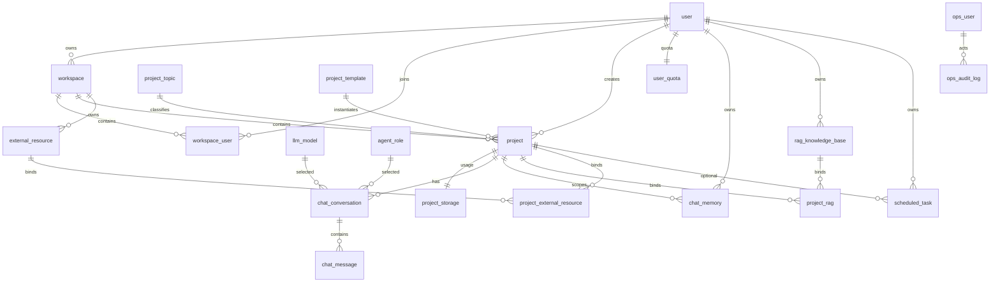

# Vibebiz 业务数据库设计

| 项 | 内容 |
|---|---|
| 日期 | 2026-10-28 |
| 状态 | 设计稿 |
| 数据库 | MySQL 8 |
| Schema | `vibebiz` |
| 范围 | 用户、运营账号、工作区、项目、主题、模板、模型、Agent 角色、定时任务、外接资源、存储额度、对话、记忆、RAG |
| 关联 | `docs/AI-Coding-Platform-技术设计文档.md`、`.ai/rules/sandbox-architecture.md` |

---

## 1. 设计结论

1. **工作区是一级归属**：`project.workspace_id` 必填；`project.user_id` 记录创建者。项目访问权限由 `workspace_user` 决定。
2. **用户与运营账号分离**：业务用户 `user`，运营后台用户 `ops_user`。
3. **模型单表双层**：`llm_model.scope=platform|user`；平台模型 `user_id=0`，用户 BYOK 使用真实用户 ID。
4. **存储双层**：`project_storage` 记录项目用量；`user_quota` 记录用户总额度与聚合用量。
5. **会话项目级**：`chat_conversation` 必须绑定 `workspace_id + project_id`。
6. **记忆双层**：`chat_memory.scope=user|project`；项目级记忆绑定 `project_id`。
7. **RAG 用户级 + 项目绑定**：`rag_knowledge_base` 属于用户，`project_rag` 绑定项目。
8. **外接资源工作区级 + 项目绑定**：`external_resource` 属于工作区，`project_external_resource` 绑定项目。
9. **定时任务通用化**：`scheduled_task` 属于用户；`project_id` 可空，`task_type` 区分 Agent / Webhook / Cleanup。
10. **Agent 角色先平台内置**：`agent_role` 不做用户自定义；后续需要时再加 `scope`。
11. **ops 前缀只给运营身份与审计**：`ops_user`、`ops_audit_log`；主题、模板、模型等属于业务目录，不加 `ops_`。
12. **统一公共字段**：所有表都有 `created_at`、`updated_at`、`deleted_at`、`extra_p JSON`。
13. **逻辑删除**：`deleted_at IS NULL` 表示有效；唯一键不自动释放，重新启用时恢复原行。
14. **不建物理外键**：所有关联靠索引 + 应用层校验，避免迁移锁和软删除约束冲突。
15. **密钥只存密文**：`llm_model.api_key_cipher`、`external_resource.credential_cipher`；密码只存哈希。

## 2. 命名与公共约定

### 2.1 命名

- 表名统一单数：`user`、`project`、`chat_message`。
- 关联表使用 `a_b`：`workspace_user`、`project_rag`、`project_external_resource`。
- 运营表使用 `ops_` 前缀：`ops_user`、`ops_audit_log`。
- 平台目录表不加 `ops_`：`project_topic`、`project_template`、`agent_role`、`llm_model`。
- 主键统一 `id BIGINT UNSIGNED AUTO_INCREMENT`。
- 时间统一 `created_at`、`updated_at`、`deleted_at`。
- 扩展字段统一 `extra_p JSON`，禁止把密钥放入 `extra_p`。

### 2.2 状态约定

| 字段 | 取值 |
|---|---|
| `user.status` / `ops_user.status` | `1` 正常，`0` 禁用 |
| `workspace_user.role` | `owner` / `admin` / `editor` / `viewer` |
| `project.status` | `draft` / `active` / `archived` |
| `llm_model.scope` | `platform` / `user` |
| `llm_model.model_type` | `LLM` / `EMBEDDING` / `RERANK` / `OCR` / `OTHER` |
| `scheduled_task.task_type` | `agent` / `webhook` / `cleanup` |
| `chat_conversation.status` | `active` / `archived`（删除由 `deleted_at` 表达） |
| `chat_message.role` | `user` / `assistant` / `system` / `tool` |
| `chat_message.status` | `pending` / `streaming` / `completed` / `error` / `stopped` |
| `chat_memory.scope` | `user` / `project` |
| `chat_memory.mem_type` | `daily_summary` / `topic_summary` / `key_fact` / `preference` |

### 2.3 软删除与唯一键

- 软删除统一使用 `deleted_at DATETIME NULL`。
- 邮箱、用户名、工作区成员等唯一键不因软删除释放；重新邀请/启用时更新原行并清空 `deleted_at`。
- `chat_conversation` 的外部 IM 唯一键为 `(source, ext_chat_id)`；`ext_chat_id` 允许 `NULL`，避免客户端会话互相冲突。
- 平台行使用 `owner_id=0` 代替 `NULL`，保证联合唯一键有效：
  - `llm_model.user_id=0` 表示平台模型。
  - `project_template.workspace_id=0` 表示平台模板。

## 3. 数据模型总览



## 4. 表清单与职责

| 分组 | 表 | 职责 | 主要写入方 |
|---|---|---|---|
| 身份 | `user` | 业务用户、头像、S3 头像路径、登录信息 | CP |
| 身份 | `ops_user` | 运营后台账号 | CP admin |
| 工作区 | `workspace` | 个人/团队工作区，S3 前缀与本地路径 | CP |
| 工作区 | `workspace_user` | 工作区成员与角色 | CP |
| 工作区 | `user_quota` | 用户存储、项目、Token、沙箱额度 | CP |
| 项目 | `project_topic` | common/game/video/slides 主题与提示词 | CP admin seed |
| 项目 | `project` | 项目元数据、主题、S3/本地路径、结构、公开状态 | CP |
| 项目 | `project_template` | 平台/工作区标准模板 | CP admin/CP |
| 项目 | `project_storage` | 项目文件大小、文件数、文件树 | DP/扫描任务 |
| 外接资源 | `external_resource` | S3/GitHub/Obsidian/Dropbox 等资源定义 | CP |
| 外接资源 | `project_external_resource` | 项目与资源绑定 | CP |
| AI 资源 | `llm_model` | 平台模型 + 用户 BYOK | CP |
| AI 资源 | `agent_role` | 平台内置 Agent 角色与提示词 | CP admin seed |
| AI 资源 | `scheduled_task` | 用户通用定时任务，可绑定项目 | CP |
| 对话 | `chat_conversation` | 项目级会话 | DP |
| 对话 | `chat_message` | 消息、附件、命令、流式状态、commit | DP |
| 对话 | `chat_memory` | 用户级/项目级记忆归纳 | DP |
| 知识库 | `rag_knowledge_base` | 用户知识库与 embedding/reranker | CP |
| 知识库 | `project_rag` | 项目挂载知识库 | CP |
| 运营 | `ops_audit_log` | 管理操作审计 | CP admin |

## 5. 服务写入边界

| 服务 | 可写表 | 说明 |
|---|---|---|
| CP | `user`、`ops_user`、`workspace`、`workspace_user`、`user_quota`、`project_topic`、`project`、`project_template`、`external_resource`、`project_external_resource`、`llm_model`、`agent_role`、`scheduled_task`、`rag_knowledge_base`、`project_rag`、`ops_audit_log` | 身份、元数据、目录、配额、管理 |
| DP | `chat_conversation`、`chat_message`、`chat_memory`、`project_storage` | 项目数据面；按项目租约路由 |
| sandbox | 不直接访问 MySQL | 只读写工作区和 `.vibebiz/`；通过 DP 回写元数据 |
| Redis | 无持久业务表 | 会话缓存、限流、SSE 活跃数、短期幂等键；不是真相源 |
| S3 | 无表 | 用户头像、项目文件、模板包、RAG 文档、附件 |

> 运行态 `project_lease`、`sandbox_node` 等不在本文范围，见 `.ai/rules/sandbox-architecture.md`；落库时同样补 `extra_p`。

---

## 6. DDL

> 约定：以下 DDL 不包含物理外键；`deleted_at` 为逻辑删除；`extra_p` 为统一扩展字段。实际部署前由迁移工具执行。

```sql
CREATE DATABASE IF NOT EXISTS `vibebiz`
  DEFAULT CHARACTER SET utf8mb4
  COLLATE utf8mb4_unicode_ci;

USE `vibebiz`;
```

### 6.1 用户与运营账号

```sql
CREATE TABLE `user` (
  `id` bigint UNSIGNED NOT NULL AUTO_INCREMENT COMMENT '主键id',
  `email` varchar(255) NOT NULL COMMENT '邮箱',
  `source` varchar(32) NOT NULL DEFAULT 'CUSTOM' COMMENT '来源：CUSTOM/OAUTH',
  `username` varchar(255) NOT NULL COMMENT '用户名',
  `password_hash` varchar(255) DEFAULT NULL COMMENT '密码哈希；OAuth 用户可为空',
  `nickname` varchar(255) DEFAULT NULL COMMENT '昵称',
  `phone_number` varchar(32) DEFAULT NULL COMMENT '手机号',
  `avatar_url` varchar(1024) DEFAULT NULL COMMENT '头像 URL',
  `avatar_s3_path` varchar(1024) DEFAULT NULL COMMENT '头像 S3 对象路径',
  `status` tinyint UNSIGNED NOT NULL DEFAULT 1 COMMENT '状态：1正常，0禁用',
  `email_verified_at` datetime DEFAULT NULL COMMENT '邮箱验证时间',
  `last_login_time` datetime DEFAULT NULL COMMENT '最后登录时间',
  `last_login_ip` varchar(64) DEFAULT NULL COMMENT '最后登录 IP',
  `created_at` timestamp NOT NULL DEFAULT CURRENT_TIMESTAMP COMMENT '创建时间',
  `updated_at` timestamp NOT NULL DEFAULT CURRENT_TIMESTAMP ON UPDATE CURRENT_TIMESTAMP COMMENT '更新时间',
  `deleted_at` datetime DEFAULT NULL COMMENT 'gorm 软删除时间',
  `extra_p` json DEFAULT NULL COMMENT '扩展字段，禁止存放密钥',
  PRIMARY KEY (`id`),
  UNIQUE KEY `uk_user_email` (`email`),
  UNIQUE KEY `uk_user_username` (`username`),
  KEY `idx_user_status_created` (`status`, `created_at`)
) ENGINE=InnoDB DEFAULT CHARSET=utf8mb4 COLLATE=utf8mb4_unicode_ci COMMENT='业务用户表';

CREATE TABLE `ops_user` (
  `id` bigint UNSIGNED NOT NULL AUTO_INCREMENT COMMENT '主键id',
  `username` varchar(255) NOT NULL COMMENT '运营用户名',
  `email` varchar(255) NOT NULL COMMENT '运营邮箱',
  `password_hash` varchar(255) DEFAULT NULL COMMENT '密码哈希；SSO 可为空',
  `nickname` varchar(255) DEFAULT NULL COMMENT '昵称',
  `phone_number` varchar(32) DEFAULT NULL COMMENT '手机号',
  `avatar_url` varchar(1024) DEFAULT NULL COMMENT '头像 URL',
  `role_code` varchar(32) NOT NULL DEFAULT 'operator' COMMENT '角色：super_admin/operator/viewer',
  `source` varchar(32) NOT NULL DEFAULT 'local' COMMENT '来源：local/SSO',
  `status` tinyint UNSIGNED NOT NULL DEFAULT 1 COMMENT '状态：1正常，0禁用',
  `last_login_time` datetime DEFAULT NULL COMMENT '最后登录时间',
  `last_login_ip` varchar(64) DEFAULT NULL COMMENT '最后登录 IP',
  `created_by` varchar(255) DEFAULT NULL COMMENT '创建者',
  `updated_by` varchar(255) DEFAULT NULL COMMENT '更新者',
  `created_at` timestamp NOT NULL DEFAULT CURRENT_TIMESTAMP COMMENT '创建时间',
  `updated_at` timestamp NOT NULL DEFAULT CURRENT_TIMESTAMP ON UPDATE CURRENT_TIMESTAMP COMMENT '更新时间',
  `deleted_at` datetime DEFAULT NULL COMMENT 'gorm 软删除时间',
  `extra_p` json DEFAULT NULL COMMENT '扩展字段',
  PRIMARY KEY (`id`),
  UNIQUE KEY `uk_ops_user_email` (`email`),
  UNIQUE KEY `uk_ops_user_username` (`username`),
  KEY `idx_ops_user_role_status` (`role_code`, `status`)
) ENGINE=InnoDB DEFAULT CHARSET=utf8mb4 COLLATE=utf8mb4_unicode_ci COMMENT='运营后台用户表';

CREATE TABLE `ops_audit_log` (
  `id` bigint UNSIGNED NOT NULL AUTO_INCREMENT COMMENT '主键id',
  `ops_user_id` bigint UNSIGNED DEFAULT NULL COMMENT '运营用户ID；系统操作可为空',
  `actor_name` varchar(255) DEFAULT NULL COMMENT '操作者名称快照',
  `action` varchar(128) NOT NULL COMMENT '操作：user.disable/project.delete/model.update',
  `resource_type` varchar(64) NOT NULL COMMENT '资源类型',
  `resource_id` varchar(64) DEFAULT NULL COMMENT '资源ID',
  `request_method` varchar(16) DEFAULT NULL COMMENT 'HTTP 方法',
  `request_path` varchar(512) DEFAULT NULL COMMENT '请求路径',
  `request_id` varchar(64) DEFAULT NULL COMMENT '请求ID',
  `trace_id` varchar(64) DEFAULT NULL COMMENT 'Trace ID',
  `ip` varchar(64) DEFAULT NULL COMMENT '来源 IP',
  `user_agent` varchar(512) DEFAULT NULL COMMENT 'User-Agent',
  `before_data` json DEFAULT NULL COMMENT '变更前快照，敏感字段脱敏',
  `after_data` json DEFAULT NULL COMMENT '变更后快照，敏感字段脱敏',
  `result_status` varchar(16) NOT NULL DEFAULT 'success' COMMENT 'success/failed',
  `error_message` varchar(1000) DEFAULT NULL COMMENT '错误信息',
  `created_at` timestamp NOT NULL DEFAULT CURRENT_TIMESTAMP COMMENT '创建时间',
  `updated_at` timestamp NOT NULL DEFAULT CURRENT_TIMESTAMP ON UPDATE CURRENT_TIMESTAMP COMMENT '更新时间',
  `deleted_at` datetime DEFAULT NULL COMMENT '逻辑删除时间',
  `extra_p` json DEFAULT NULL COMMENT '扩展字段',
  PRIMARY KEY (`id`),
  KEY `idx_ops_audit_user_time` (`ops_user_id`, `created_at`),
  KEY `idx_ops_audit_resource` (`resource_type`, `resource_id`),
  KEY `idx_ops_audit_request` (`request_id`)
) ENGINE=InnoDB DEFAULT CHARSET=utf8mb4 COLLATE=utf8mb4_unicode_ci COMMENT='运营操作审计表';
```

### 6.2 工作区与额度

```sql
CREATE TABLE `workspace` (
  `id` bigint UNSIGNED NOT NULL AUTO_INCREMENT COMMENT '主键id',
  `owner_user_id` bigint UNSIGNED NOT NULL COMMENT '工作区所有者用户ID',
  `name` varchar(128) NOT NULL COMMENT '工作区名称',
  `description` varchar(1000) DEFAULT NULL COMMENT '工作区描述',
  `workspace_type` varchar(16) NOT NULL DEFAULT 'personal' COMMENT 'personal/team',
  `visibility` varchar(16) NOT NULL DEFAULT 'private' COMMENT 'private/shared',
  `s3_prefix` varchar(1024) DEFAULT NULL COMMENT '工作区 S3 前缀',
  `local_path` varchar(1024) DEFAULT NULL COMMENT '工作区本地/RWX 路径',
  `status` tinyint UNSIGNED NOT NULL DEFAULT 1 COMMENT '状态：1正常，0禁用',
  `created_by` varchar(255) DEFAULT NULL COMMENT '创建者',
  `updated_by` varchar(255) DEFAULT NULL COMMENT '更新者',
  `created_at` timestamp NOT NULL DEFAULT CURRENT_TIMESTAMP COMMENT '创建时间',
  `updated_at` timestamp NOT NULL DEFAULT CURRENT_TIMESTAMP ON UPDATE CURRENT_TIMESTAMP COMMENT '更新时间',
  `deleted_at` datetime DEFAULT NULL COMMENT 'gorm 软删除时间',
  `extra_p` json DEFAULT NULL COMMENT '扩展字段',
  PRIMARY KEY (`id`),
  KEY `idx_workspace_owner` (`owner_user_id`, `deleted_at`),
  KEY `idx_workspace_type_status` (`workspace_type`, `status`)
) ENGINE=InnoDB DEFAULT CHARSET=utf8mb4 COLLATE=utf8mb4_unicode_ci COMMENT='工作区表';

CREATE TABLE `workspace_user` (
  `id` bigint UNSIGNED NOT NULL AUTO_INCREMENT COMMENT '主键id',
  `workspace_id` bigint UNSIGNED NOT NULL COMMENT '工作区ID',
  `user_id` bigint UNSIGNED NOT NULL COMMENT '用户ID',
  `role` varchar(16) NOT NULL DEFAULT 'editor' COMMENT 'owner/admin/editor/viewer',
  `status` tinyint UNSIGNED NOT NULL DEFAULT 1 COMMENT '状态：1正常，0禁用',
  `invited_by` bigint UNSIGNED DEFAULT NULL COMMENT '邀请人用户ID',
  `joined_at` datetime DEFAULT NULL COMMENT '加入时间',
  `last_access_at` datetime DEFAULT NULL COMMENT '最近访问时间',
  `created_at` timestamp NOT NULL DEFAULT CURRENT_TIMESTAMP COMMENT '创建时间',
  `updated_at` timestamp NOT NULL DEFAULT CURRENT_TIMESTAMP ON UPDATE CURRENT_TIMESTAMP COMMENT '更新时间',
  `deleted_at` datetime DEFAULT NULL COMMENT 'gorm 软删除时间',
  `extra_p` json DEFAULT NULL COMMENT '扩展字段',
  PRIMARY KEY (`id`),
  UNIQUE KEY `uk_workspace_user` (`workspace_id`, `user_id`),
  KEY `idx_workspace_user_user` (`user_id`, `status`, `deleted_at`)
) ENGINE=InnoDB DEFAULT CHARSET=utf8mb4 COLLATE=utf8mb4_unicode_ci COMMENT='工作区用户绑定表';

CREATE TABLE `user_quota` (
  `id` bigint UNSIGNED NOT NULL AUTO_INCREMENT COMMENT '主键id',
  `user_id` bigint UNSIGNED NOT NULL COMMENT '用户ID',
  `plan_code` varchar(32) NOT NULL DEFAULT 'free' COMMENT '套餐：free/pro/max',
  `storage_quota_bytes` bigint UNSIGNED NOT NULL DEFAULT 0 COMMENT '存储额度，0 表示不限',
  `storage_used_bytes` bigint UNSIGNED NOT NULL DEFAULT 0 COMMENT '已用存储字节',
  `project_quota` int UNSIGNED NOT NULL DEFAULT 0 COMMENT '项目额度，0 表示不限',
  `project_used` int UNSIGNED NOT NULL DEFAULT 0 COMMENT '已用项目数',
  `workspace_quota` int UNSIGNED NOT NULL DEFAULT 0 COMMENT '工作区额度，0 表示不限',
  `workspace_used` int UNSIGNED NOT NULL DEFAULT 0 COMMENT '已用工作区数',
  `llm_token_quota_month` bigint UNSIGNED NOT NULL DEFAULT 0 COMMENT '月度 Token 额度，0 表示不限',
  `llm_tokens_used_month` bigint UNSIGNED NOT NULL DEFAULT 0 COMMENT '本月已用 Token',
  `sandbox_minutes_quota_month` int UNSIGNED NOT NULL DEFAULT 0 COMMENT '月度沙箱分钟额度，0 表示不限',
  `sandbox_minutes_used_month` int UNSIGNED NOT NULL DEFAULT 0 COMMENT '本月已用沙箱分钟',
  `concurrent_agent_runs` int UNSIGNED NOT NULL DEFAULT 1 COMMENT '并发 Agent 运行上限',
  `reset_at` datetime DEFAULT NULL COMMENT '月度额度重置时间',
  `status` tinyint UNSIGNED NOT NULL DEFAULT 1 COMMENT '状态：1正常，0冻结',
  `created_at` timestamp NOT NULL DEFAULT CURRENT_TIMESTAMP COMMENT '创建时间',
  `updated_at` timestamp NOT NULL DEFAULT CURRENT_TIMESTAMP ON UPDATE CURRENT_TIMESTAMP COMMENT '更新时间',
  `deleted_at` datetime DEFAULT NULL COMMENT 'gorm 软删除时间',
  `extra_p` json DEFAULT NULL COMMENT '扩展字段',
  PRIMARY KEY (`id`),
  UNIQUE KEY `uk_user_quota_user` (`user_id`)
) ENGINE=InnoDB DEFAULT CHARSET=utf8mb4 COLLATE=utf8mb4_unicode_ci COMMENT='用户额度与聚合用量表';
```

### 6.3 主题、模板与项目

```sql
CREATE TABLE `project_topic` (
  `id` bigint UNSIGNED NOT NULL AUTO_INCREMENT COMMENT '主键id',
  `topic_code` varchar(32) NOT NULL COMMENT '主题编码：common/game/video/slides',
  `topic_name` varchar(64) NOT NULL COMMENT '主题名称',
  `description` varchar(1000) DEFAULT NULL COMMENT '主题说明',
  `prompt_template` mediumtext COMMENT '主题提示词模板',
  `icon` varchar(255) DEFAULT NULL COMMENT '图标 URL 或标识',
  `default_template_id` bigint UNSIGNED DEFAULT NULL COMMENT '默认模板ID',
  `is_default` tinyint(1) NOT NULL DEFAULT 0 COMMENT '是否默认主题',
  `sort_order` int NOT NULL DEFAULT 0 COMMENT '排序',
  `status` tinyint UNSIGNED NOT NULL DEFAULT 1 COMMENT '状态：1启用，0禁用',
  `created_by` varchar(255) DEFAULT NULL COMMENT '创建者',
  `updated_by` varchar(255) DEFAULT NULL COMMENT '更新者',
  `created_at` timestamp NOT NULL DEFAULT CURRENT_TIMESTAMP COMMENT '创建时间',
  `updated_at` timestamp NOT NULL DEFAULT CURRENT_TIMESTAMP ON UPDATE CURRENT_TIMESTAMP COMMENT '更新时间',
  `deleted_at` datetime DEFAULT NULL COMMENT 'gorm 软删除时间',
  `extra_p` json DEFAULT NULL COMMENT '扩展字段',
  PRIMARY KEY (`id`),
  UNIQUE KEY `uk_project_topic_code` (`topic_code`),
  KEY `idx_project_topic_status_sort` (`status`, `sort_order`)
) ENGINE=InnoDB DEFAULT CHARSET=utf8mb4 COLLATE=utf8mb4_unicode_ci COMMENT='工程主题表';

CREATE TABLE `project_template` (
  `id` bigint UNSIGNED NOT NULL AUTO_INCREMENT COMMENT '主键id',
  `scope` varchar(16) NOT NULL DEFAULT 'platform' COMMENT 'platform/workspace',
  `workspace_id` bigint UNSIGNED NOT NULL DEFAULT 0 COMMENT '工作区ID；0=平台模板',
  `template_code` varchar(64) NOT NULL COMMENT '模板编码',
  `template_name` varchar(128) NOT NULL COMMENT '模板名称',
  `description` varchar(1000) DEFAULT NULL COMMENT '模板描述',
  `topic_id` bigint UNSIGNED NOT NULL COMMENT '主题ID',
  `template_s3_path` varchar(1024) DEFAULT NULL COMMENT '模板包 S3 路径',
  `cover_url` varchar(1024) DEFAULT NULL COMMENT '封面 URL',
  `template_label` json DEFAULT NULL COMMENT '模板标签数组',
  `file_tree` json DEFAULT NULL COMMENT '模板文件树',
  `tech_stack` json DEFAULT NULL COMMENT '技术栈',
  `version` int UNSIGNED NOT NULL DEFAULT 1 COMMENT '模板版本',
  `is_builtin` tinyint(1) NOT NULL DEFAULT 0 COMMENT '是否内置',
  `status` tinyint UNSIGNED NOT NULL DEFAULT 1 COMMENT '状态：1启用，0禁用',
  `sort_order` int NOT NULL DEFAULT 0 COMMENT '排序',
  `created_by` varchar(255) DEFAULT NULL COMMENT '创建者',
  `updated_by` varchar(255) DEFAULT NULL COMMENT '更新者',
  `created_at` timestamp NOT NULL DEFAULT CURRENT_TIMESTAMP COMMENT '创建时间',
  `updated_at` timestamp NOT NULL DEFAULT CURRENT_TIMESTAMP ON UPDATE CURRENT_TIMESTAMP COMMENT '更新时间',
  `deleted_at` datetime DEFAULT NULL COMMENT 'gorm 软删除时间',
  `extra_p` json DEFAULT NULL COMMENT '扩展字段',
  PRIMARY KEY (`id`),
  UNIQUE KEY `uk_template_scope_owner_code` (`scope`, `workspace_id`, `template_code`),
  KEY `idx_template_topic_status` (`topic_id`, `status`, `sort_order`),
  KEY `idx_template_owner_status` (`scope`, `workspace_id`, `status`)
) ENGINE=InnoDB DEFAULT CHARSET=utf8mb4 COLLATE=utf8mb4_unicode_ci COMMENT='工程模板表';

CREATE TABLE `project` (
  `id` bigint UNSIGNED NOT NULL AUTO_INCREMENT COMMENT '主键id',
  `workspace_id` bigint UNSIGNED NOT NULL COMMENT '所属工作区ID',
  `user_id` bigint UNSIGNED NOT NULL COMMENT '创建者/负责人用户ID',
  `name` varchar(255) NOT NULL COMMENT '项目名',
  `description` varchar(2000) DEFAULT NULL COMMENT '项目描述',
  `topic_id` bigint UNSIGNED NOT NULL COMMENT '主题ID，默认 common',
  `template_id` bigint UNSIGNED DEFAULT NULL COMMENT '创建时使用的模板ID',
  `s3_path` varchar(1024) DEFAULT NULL COMMENT '项目 S3 前缀',
  `local_path` varchar(1024) DEFAULT NULL COMMENT '项目本地/RWX 路径',
  `project_structure` json DEFAULT NULL COMMENT '项目结构快照：页面/路由/文件树',
  `is_public` tinyint(1) NOT NULL DEFAULT 0 COMMENT '是否公开：0私有，1公开',
  `status` varchar(16) NOT NULL DEFAULT 'active' COMMENT 'draft/active/archived',
  `default_agent_role_id` bigint UNSIGNED DEFAULT NULL COMMENT '默认 Agent 角色ID',
  `last_active_at` datetime DEFAULT NULL COMMENT '最近活跃时间',
  `archived_at` datetime DEFAULT NULL COMMENT '归档时间',
  `created_by` varchar(255) DEFAULT NULL COMMENT '创建者',
  `updated_by` varchar(255) DEFAULT NULL COMMENT '更新者',
  `created_at` timestamp NOT NULL DEFAULT CURRENT_TIMESTAMP COMMENT '创建时间',
  `updated_at` timestamp NOT NULL DEFAULT CURRENT_TIMESTAMP ON UPDATE CURRENT_TIMESTAMP COMMENT '更新时间',
  `deleted_at` datetime DEFAULT NULL COMMENT 'gorm 软删除时间',
  `extra_p` json DEFAULT NULL COMMENT '扩展字段',
  PRIMARY KEY (`id`),
  KEY `idx_project_workspace_updated` (`workspace_id`, `deleted_at`, `updated_at`),
  KEY `idx_project_user` (`user_id`, `deleted_at`),
  KEY `idx_project_topic` (`topic_id`),
  KEY `idx_project_public` (`is_public`, `updated_at`)
) ENGINE=InnoDB DEFAULT CHARSET=utf8mb4 COLLATE=utf8mb4_unicode_ci COMMENT='项目表';

CREATE TABLE `project_storage` (
  `id` bigint UNSIGNED NOT NULL AUTO_INCREMENT COMMENT '主键id',
  `workspace_id` bigint UNSIGNED NOT NULL COMMENT '工作区ID',
  `project_id` bigint UNSIGNED NOT NULL COMMENT '项目ID',
  `user_id` bigint UNSIGNED NOT NULL COMMENT '归属用户ID/创建者',
  `storage_path` varchar(1024) DEFAULT NULL COMMENT '文件存储地址：S3 前缀或本地路径',
  `file_size_bytes` bigint UNSIGNED NOT NULL DEFAULT 0 COMMENT '文件总大小',
  `file_count` int UNSIGNED NOT NULL DEFAULT 0 COMMENT '文件数',
  `dir_count` int UNSIGNED NOT NULL DEFAULT 0 COMMENT '目录数',
  `file_tree` json DEFAULT NULL COMMENT '文件树快照',
  `last_modified_at` datetime DEFAULT NULL COMMENT '文件最后修改时间',
  `last_scanned_at` datetime DEFAULT NULL COMMENT '最近扫描时间',
  `status` tinyint UNSIGNED NOT NULL DEFAULT 1 COMMENT '状态：1正常，0异常',
  `created_at` timestamp NOT NULL DEFAULT CURRENT_TIMESTAMP COMMENT '创建时间',
  `updated_at` timestamp NOT NULL DEFAULT CURRENT_TIMESTAMP ON UPDATE CURRENT_TIMESTAMP COMMENT '更新时间',
  `deleted_at` datetime DEFAULT NULL COMMENT 'gorm 软删除时间',
  `extra_p` json DEFAULT NULL COMMENT '扩展字段',
  PRIMARY KEY (`id`),
  UNIQUE KEY `uk_project_storage_project` (`project_id`),
  KEY `idx_project_storage_workspace` (`workspace_id`, `deleted_at`),
  KEY `idx_project_storage_user` (`user_id`, `deleted_at`)
) ENGINE=InnoDB DEFAULT CHARSET=utf8mb4 COLLATE=utf8mb4_unicode_ci COMMENT='项目存储用量表';
```

### 6.4 外接资源

```sql
CREATE TABLE `external_resource` (
  `id` bigint UNSIGNED NOT NULL AUTO_INCREMENT COMMENT '主键id',
  `workspace_id` bigint UNSIGNED NOT NULL COMMENT '所属工作区ID',
  `user_id` bigint UNSIGNED NOT NULL COMMENT '创建者用户ID',
  `name` varchar(128) NOT NULL COMMENT '资源名称',
  `resource_type` varchar(32) NOT NULL COMMENT 's3/github/obsidian/dropbox/url',
  `resource_url` varchar(2048) NOT NULL COMMENT '资源 URL/仓库地址',
  `auth_type` varchar(32) NOT NULL DEFAULT 'none' COMMENT 'none/token/oauth/basic',
  `credential_cipher` text COMMENT '加密后的凭据，禁止明文',
  `extra_configs` json DEFAULT NULL COMMENT '非敏感扩展配置',
  `sync_status` varchar(16) NOT NULL DEFAULT 'pending' COMMENT 'pending/syncing/success/failed',
  `last_sync_at` datetime DEFAULT NULL COMMENT '最近同步时间',
  `last_error` varchar(1000) DEFAULT NULL COMMENT '最近同步错误',
  `status` tinyint UNSIGNED NOT NULL DEFAULT 1 COMMENT '状态：1启用，0禁用',
  `created_by` varchar(255) DEFAULT NULL COMMENT '创建者',
  `updated_by` varchar(255) DEFAULT NULL COMMENT '更新者',
  `created_at` timestamp NOT NULL DEFAULT CURRENT_TIMESTAMP COMMENT '创建时间',
  `updated_at` timestamp NOT NULL DEFAULT CURRENT_TIMESTAMP ON UPDATE CURRENT_TIMESTAMP COMMENT '更新时间',
  `deleted_at` datetime DEFAULT NULL COMMENT 'gorm 软删除时间',
  `extra_p` json DEFAULT NULL COMMENT '扩展字段',
  PRIMARY KEY (`id`),
  KEY `idx_external_workspace_type` (`workspace_id`, `resource_type`, `status`, `deleted_at`)
) ENGINE=InnoDB DEFAULT CHARSET=utf8mb4 COLLATE=utf8mb4_unicode_ci COMMENT='外接资源表';

CREATE TABLE `project_external_resource` (
  `id` bigint UNSIGNED NOT NULL AUTO_INCREMENT COMMENT '主键id',
  `workspace_id` bigint UNSIGNED NOT NULL COMMENT '工作区ID',
  `project_id` bigint UNSIGNED NOT NULL COMMENT '项目ID',
  `resource_id` bigint UNSIGNED NOT NULL COMMENT '外接资源ID',
  `created_by` varchar(255) DEFAULT NULL COMMENT '创建者',
  `created_at` timestamp NOT NULL DEFAULT CURRENT_TIMESTAMP COMMENT '创建时间',
  `updated_at` timestamp NOT NULL DEFAULT CURRENT_TIMESTAMP ON UPDATE CURRENT_TIMESTAMP COMMENT '更新时间',
  `deleted_at` datetime DEFAULT NULL COMMENT 'gorm 软删除时间',
  `extra_p` json DEFAULT NULL COMMENT '扩展字段',
  PRIMARY KEY (`id`),
  UNIQUE KEY `uk_project_external_resource` (`project_id`, `resource_id`),
  KEY `idx_project_external_resource_resource` (`resource_id`, `deleted_at`)
) ENGINE=InnoDB DEFAULT CHARSET=utf8mb4 COLLATE=utf8mb4_unicode_ci COMMENT='项目外接资源绑定表';
```

### 6.5 模型、角色与定时任务

```sql
CREATE TABLE `llm_model` (
  `id` bigint UNSIGNED NOT NULL AUTO_INCREMENT COMMENT '主键id',
  `scope` varchar(16) NOT NULL DEFAULT 'user' COMMENT 'platform/user',
  `user_id` bigint UNSIGNED NOT NULL DEFAULT 0 COMMENT '用户ID；0=平台模型',
  `model_name` varchar(128) NOT NULL COMMENT '模型名称',
  `model_code` varchar(64) NOT NULL COMMENT '模型编码',
  `api_url` varchar(512) NOT NULL COMMENT 'API URL',
  `api_key_cipher` varchar(2048) NOT NULL COMMENT '加密后的 API Key',
  `provider_code` varchar(32) NOT NULL DEFAULT 'Other' COMMENT 'OpenAI/DeepSeek/Anthropic/Qwen/Other',
  `model_type` varchar(32) NOT NULL DEFAULT 'LLM' COMMENT 'LLM/EMBEDDING/RERANK/OCR/OTHER',
  `max_tokens` int NOT NULL DEFAULT 4096 COMMENT '最大输出 token',
  `context_window` int UNSIGNED DEFAULT NULL COMMENT '上下文窗口',
  `is_small_model` tinyint(1) NOT NULL DEFAULT 0 COMMENT '是否小模型',
  `is_default` tinyint(1) NOT NULL DEFAULT 0 COMMENT '是否默认模型',
  `established` tinyint(1) NOT NULL DEFAULT 0 COMMENT '是否连通：0断开，1连通',
  `status` tinyint UNSIGNED NOT NULL DEFAULT 1 COMMENT '状态：1启用，0禁用',
  `extra_params` json DEFAULT NULL COMMENT '模型扩展参数',
  `created_by` varchar(255) DEFAULT NULL COMMENT '创建者',
  `updated_by` varchar(255) DEFAULT NULL COMMENT '更新者',
  `created_at` timestamp NOT NULL DEFAULT CURRENT_TIMESTAMP COMMENT '创建时间',
  `updated_at` timestamp NOT NULL DEFAULT CURRENT_TIMESTAMP ON UPDATE CURRENT_TIMESTAMP COMMENT '更新时间',
  `deleted_at` datetime DEFAULT NULL COMMENT 'gorm 软删除时间',
  `extra_p` json DEFAULT NULL COMMENT '扩展字段',
  PRIMARY KEY (`id`),
  UNIQUE KEY `uk_llm_model_owner_code` (`scope`, `user_id`, `model_code`),
  KEY `idx_llm_model_owner_type` (`scope`, `user_id`, `model_type`, `status`),
  KEY `idx_llm_model_code` (`model_code`)
) ENGINE=InnoDB DEFAULT CHARSET=utf8mb4 COLLATE=utf8mb4_unicode_ci COMMENT='LLM模型表';

CREATE TABLE `agent_role` (
  `id` bigint UNSIGNED NOT NULL AUTO_INCREMENT COMMENT '主键id',
  `role_code` varchar(32) NOT NULL COMMENT '角色编码：alex/bob/david/emma/mike',
  `role_name_en` varchar(64) NOT NULL COMMENT '英文名',
  `role_name_zh` varchar(64) NOT NULL COMMENT '中文名',
  `description` varchar(1000) DEFAULT NULL COMMENT '角色说明',
  `system_prompt` mediumtext COMMENT '角色提示词',
  `avatar_url` varchar(1024) DEFAULT NULL COMMENT '角色头像',
  `is_builtin` tinyint(1) NOT NULL DEFAULT 0 COMMENT '是否内置',
  `status` tinyint UNSIGNED NOT NULL DEFAULT 1 COMMENT '状态：1启用，0禁用',
  `sort_order` int NOT NULL DEFAULT 0 COMMENT '排序',
  `version` int UNSIGNED NOT NULL DEFAULT 1 COMMENT '提示词版本',
  `created_by` varchar(255) DEFAULT NULL COMMENT '创建者',
  `updated_by` varchar(255) DEFAULT NULL COMMENT '更新者',
  `created_at` timestamp NOT NULL DEFAULT CURRENT_TIMESTAMP COMMENT '创建时间',
  `updated_at` timestamp NOT NULL DEFAULT CURRENT_TIMESTAMP ON UPDATE CURRENT_TIMESTAMP COMMENT '更新时间',
  `deleted_at` datetime DEFAULT NULL COMMENT 'gorm 软删除时间',
  `extra_p` json DEFAULT NULL COMMENT '扩展字段',
  PRIMARY KEY (`id`),
  UNIQUE KEY `uk_agent_role_code` (`role_code`),
  KEY `idx_agent_role_status_sort` (`status`, `sort_order`)
) ENGINE=InnoDB DEFAULT CHARSET=utf8mb4 COLLATE=utf8mb4_unicode_ci COMMENT='Agent角色表';

CREATE TABLE `scheduled_task` (
  `id` bigint UNSIGNED NOT NULL AUTO_INCREMENT COMMENT '主键id',
  `user_id` bigint UNSIGNED NOT NULL COMMENT '所属用户ID',
  `workspace_id` bigint UNSIGNED DEFAULT NULL COMMENT '可选工作区ID',
  `project_id` bigint UNSIGNED DEFAULT NULL COMMENT '可选项目ID',
  `name` varchar(128) NOT NULL COMMENT '任务名称',
  `task_type` varchar(32) NOT NULL DEFAULT 'agent' COMMENT 'agent/webhook/cleanup',
  `cron_expr` varchar(128) NOT NULL COMMENT 'cron 表达式',
  `timezone` varchar(64) NOT NULL DEFAULT 'Asia/Shanghai' COMMENT '时区',
  `prompt` mediumtext COMMENT 'Agent 任务提示词',
  `payload` json DEFAULT NULL COMMENT '任务参数：Webhook/清理配置等',
  `agent_role_id` bigint UNSIGNED DEFAULT NULL COMMENT 'Agent 角色ID',
  `model_id` bigint UNSIGNED DEFAULT NULL COMMENT '模型ID',
  `enabled` tinyint(1) NOT NULL DEFAULT 1 COMMENT '是否启用',
  `next_run_at` datetime DEFAULT NULL COMMENT '下次执行时间',
  `last_run_at` datetime DEFAULT NULL COMMENT '上次执行时间',
  `last_status` varchar(16) DEFAULT NULL COMMENT 'pending/running/success/failed',
  `last_error` varchar(1000) DEFAULT NULL COMMENT '最近错误',
  `run_count` int UNSIGNED NOT NULL DEFAULT 0 COMMENT '已执行次数',
  `max_runs` int UNSIGNED NOT NULL DEFAULT 0 COMMENT '最大次数，0 表示不限',
  `start_at` datetime DEFAULT NULL COMMENT '生效开始时间',
  `end_at` datetime DEFAULT NULL COMMENT '生效结束时间',
  `created_by` varchar(255) DEFAULT NULL COMMENT '创建者',
  `updated_by` varchar(255) DEFAULT NULL COMMENT '更新者',
  `created_at` timestamp NOT NULL DEFAULT CURRENT_TIMESTAMP COMMENT '创建时间',
  `updated_at` timestamp NOT NULL DEFAULT CURRENT_TIMESTAMP ON UPDATE CURRENT_TIMESTAMP COMMENT '更新时间',
  `deleted_at` datetime DEFAULT NULL COMMENT 'gorm 软删除时间',
  `extra_p` json DEFAULT NULL COMMENT '扩展字段',
  PRIMARY KEY (`id`),
  KEY `idx_scheduled_task_due` (`enabled`, `next_run_at`),
  KEY `idx_scheduled_task_user` (`user_id`, `enabled`, `deleted_at`),
  KEY `idx_scheduled_task_project` (`project_id`, `deleted_at`)
) ENGINE=InnoDB DEFAULT CHARSET=utf8mb4 COLLATE=utf8mb4_unicode_ci COMMENT='用户定时任务表';
```

### 6.6 对话、消息与记忆

```sql
CREATE TABLE `chat_conversation` (
  `id` bigint UNSIGNED NOT NULL AUTO_INCREMENT COMMENT '会话ID',
  `workspace_id` bigint UNSIGNED NOT NULL COMMENT '工作区ID',
  `project_id` bigint UNSIGNED NOT NULL COMMENT '项目ID',
  `user_id` bigint UNSIGNED NOT NULL COMMENT '发起用户ID',
  `title` varchar(255) NOT NULL DEFAULT '新对话' COMMENT '会话标题',
  `model_id` bigint UNSIGNED NOT NULL COMMENT '模型ID',
  `agent_role_id` bigint UNSIGNED NOT NULL COMMENT 'Agent角色ID',
  `system_prompt` mediumtext COMMENT '自定义系统提示词',
  `source` varchar(32) NOT NULL DEFAULT 'client' COMMENT 'client/feishu/wechat/dingtalk',
  `ext_chat_id` varchar(255) DEFAULT NULL COMMENT '外部 IM 会话ID',
  `status` varchar(16) NOT NULL DEFAULT 'active' COMMENT 'active/archived',
  `message_count` int UNSIGNED NOT NULL DEFAULT 0 COMMENT '消息总数冗余',
  `total_tokens` bigint UNSIGNED NOT NULL DEFAULT 0 COMMENT '累计 Token',
  `last_message_at` datetime DEFAULT NULL COMMENT '最近消息时间',
  `start_at` datetime DEFAULT NULL COMMENT '会话开始时间',
  `end_at` datetime DEFAULT NULL COMMENT '会话结束时间',
  `parent_conversation_id` bigint UNSIGNED DEFAULT NULL COMMENT 'fork 来源会话ID',
  `created_at` timestamp NOT NULL DEFAULT CURRENT_TIMESTAMP COMMENT '创建时间',
  `updated_at` timestamp NOT NULL DEFAULT CURRENT_TIMESTAMP ON UPDATE CURRENT_TIMESTAMP COMMENT '更新时间',
  `deleted_at` datetime DEFAULT NULL COMMENT 'gorm 软删除时间',
  `extra_p` json DEFAULT NULL COMMENT '扩展字段',
  PRIMARY KEY (`id`),
  UNIQUE KEY `uk_chat_conversation_ext` (`source`, `ext_chat_id`),
  KEY `idx_chat_conversation_project` (`project_id`, `status`, `updated_at`),
  KEY `idx_chat_conversation_user` (`user_id`, `updated_at`),
  KEY `idx_chat_conversation_workspace` (`workspace_id`, `updated_at`)
) ENGINE=InnoDB DEFAULT CHARSET=utf8mb4 COLLATE=utf8mb4_unicode_ci COMMENT='项目级 AI 对话会话表';

CREATE TABLE `chat_message` (
  `id` bigint UNSIGNED NOT NULL AUTO_INCREMENT COMMENT '消息ID',
  `conversation_id` bigint UNSIGNED NOT NULL COMMENT '所属会话ID',
  `role` varchar(16) NOT NULL COMMENT 'user/assistant/system/tool',
  `content` mediumtext NOT NULL COMMENT '消息内容',
  `attachments` json DEFAULT NULL COMMENT '附件列表',
  `commands` json DEFAULT NULL COMMENT '需要在客户端执行的 CLI 命令',
  `status` varchar(16) NOT NULL DEFAULT 'completed' COMMENT 'pending/streaming/completed/error/stopped',
  `error_message` text COMMENT '错误信息',
  `token_usage` int UNSIGNED DEFAULT NULL COMMENT '消耗 Token',
  `response_time_ms` int UNSIGNED DEFAULT NULL COMMENT '响应耗时毫秒',
  `parent_message_id` bigint UNSIGNED DEFAULT NULL COMMENT '父消息ID，用于分支/重新生成',
  `version` int UNSIGNED NOT NULL DEFAULT 1 COMMENT '消息版本',
  `model_id` bigint UNSIGNED DEFAULT NULL COMMENT '本条消息使用的模型ID',
  `commit_sha` varchar(64) DEFAULT NULL COMMENT '本轮产生的 git commit',
  `trace_id` varchar(64) DEFAULT NULL COMMENT 'Trace ID',
  `created_at` timestamp NOT NULL DEFAULT CURRENT_TIMESTAMP COMMENT '创建时间',
  `updated_at` timestamp NOT NULL DEFAULT CURRENT_TIMESTAMP ON UPDATE CURRENT_TIMESTAMP COMMENT '更新时间',
  `deleted_at` datetime DEFAULT NULL COMMENT 'gorm 软删除时间',
  `extra_p` json DEFAULT NULL COMMENT '扩展字段',
  PRIMARY KEY (`id`),
  KEY `idx_chat_message_conversation` (`conversation_id`, `created_at`),
  KEY `idx_chat_message_parent` (`parent_message_id`),
  KEY `idx_chat_message_status` (`status`),
  KEY `idx_chat_message_trace` (`trace_id`)
) ENGINE=InnoDB DEFAULT CHARSET=utf8mb4 COLLATE=utf8mb4_unicode_ci COMMENT='对话消息表';

CREATE TABLE `chat_memory` (
  `id` bigint UNSIGNED NOT NULL AUTO_INCREMENT COMMENT '主键ID',
  `scope` varchar(16) NOT NULL DEFAULT 'user' COMMENT 'user/project',
  `user_id` bigint UNSIGNED NOT NULL COMMENT '用户ID',
  `workspace_id` bigint UNSIGNED DEFAULT NULL COMMENT '工作区ID；项目级记忆必填',
  `project_id` bigint UNSIGNED DEFAULT NULL COMMENT '项目ID；项目级记忆必填',
  `name` varchar(255) NOT NULL COMMENT '记忆名称',
  `conversation_ids` json DEFAULT NULL COMMENT '关联会话ID列表',
  `mem` mediumtext NOT NULL COMMENT '记忆内容，Markdown',
  `mem_type` varchar(32) NOT NULL DEFAULT 'daily_summary' COMMENT 'daily_summary/topic_summary/key_fact/preference',
  `time_range_start_at` datetime DEFAULT NULL COMMENT '记忆覆盖开始时间',
  `time_range_end_at` datetime DEFAULT NULL COMMENT '记忆覆盖结束时间',
  `source_msg_count` int UNSIGNED NOT NULL DEFAULT 0 COMMENT '归纳涉及消息数',
  `version` int UNSIGNED NOT NULL DEFAULT 1 COMMENT '同类型记忆版本',
  `is_active` tinyint(1) NOT NULL DEFAULT 1 COMMENT '是否生效',
  `expire_at` datetime DEFAULT NULL COMMENT '过期时间，NULL 永久',
  `confidence_score` tinyint UNSIGNED DEFAULT NULL COMMENT '置信度 1-10',
  `created_by` varchar(255) DEFAULT NULL COMMENT '创建者：system/agent/user',
  `updated_by` varchar(255) DEFAULT NULL COMMENT '更新者',
  `created_at` timestamp NOT NULL DEFAULT CURRENT_TIMESTAMP COMMENT '创建时间',
  `updated_at` timestamp NOT NULL DEFAULT CURRENT_TIMESTAMP ON UPDATE CURRENT_TIMESTAMP COMMENT '更新时间',
  `deleted_at` datetime DEFAULT NULL COMMENT 'gorm 软删除时间',
  `extra_p` json DEFAULT NULL COMMENT '扩展字段',
  PRIMARY KEY (`id`),
  KEY `idx_chat_memory_user_scope` (`user_id`, `scope`, `is_active`, `deleted_at`),
  KEY `idx_chat_memory_project_type` (`project_id`, `mem_type`, `is_active`, `deleted_at`)
) ENGINE=InnoDB DEFAULT CHARSET=utf8mb4 COLLATE=utf8mb4_unicode_ci COMMENT='用户/项目记忆表';
```

### 6.7 知识库

```sql
CREATE TABLE `rag_knowledge_base` (
  `id` bigint UNSIGNED NOT NULL AUTO_INCREMENT COMMENT '知识库ID',
  `user_id` bigint UNSIGNED NOT NULL COMMENT '用户ID',
  `name` varchar(255) NOT NULL COMMENT '知识库名',
  `rag_desc` varchar(1000) DEFAULT NULL COMMENT '知识库描述',
  `rag_metadata` json DEFAULT NULL COMMENT '元数据',
  `chunk_size` int UNSIGNED NOT NULL DEFAULT 500 COMMENT '文档分段大小',
  `overlap_size` int UNSIGNED NOT NULL DEFAULT 50 COMMENT '文档重叠大小',
  `dimension_size` int UNSIGNED NOT NULL DEFAULT 1024 COMMENT '向量维度',
  `embedding_model_id` bigint UNSIGNED NOT NULL COMMENT '嵌入模型ID',
  `embedding_model_name` varchar(255) NOT NULL COMMENT '嵌入模型名称快照',
  `reranker_model_id` bigint UNSIGNED DEFAULT NULL COMMENT 'Reranker 模型ID',
  `reranker_model_name` varchar(255) DEFAULT NULL COMMENT 'Reranker 模型名称快照',
  `doc_count` bigint UNSIGNED NOT NULL DEFAULT 0 COMMENT '文档数量',
  `collection_name` varchar(128) NOT NULL COMMENT '向量库集合名',
  `status` tinyint UNSIGNED NOT NULL DEFAULT 1 COMMENT '状态：1启用，0禁用',
  `created_by` varchar(255) DEFAULT NULL COMMENT '创建者',
  `updated_by` varchar(255) DEFAULT NULL COMMENT '更新者',
  `created_at` timestamp NOT NULL DEFAULT CURRENT_TIMESTAMP COMMENT '创建时间',
  `updated_at` timestamp NOT NULL DEFAULT CURRENT_TIMESTAMP ON UPDATE CURRENT_TIMESTAMP COMMENT '更新时间',
  `deleted_at` datetime DEFAULT NULL COMMENT 'gorm 软删除时间',
  `extra_p` json DEFAULT NULL COMMENT '扩展字段',
  PRIMARY KEY (`id`),
  UNIQUE KEY `uk_rag_collection` (`collection_name`),
  KEY `idx_rag_user_status` (`user_id`, `status`, `deleted_at`),
  KEY `idx_rag_embedding_model` (`embedding_model_id`),
  KEY `idx_rag_reranker_model` (`reranker_model_id`)
) ENGINE=InnoDB DEFAULT CHARSET=utf8mb4 COLLATE=utf8mb4_unicode_ci COMMENT='知识库管理表';

CREATE TABLE `project_rag` (
  `id` bigint UNSIGNED NOT NULL AUTO_INCREMENT COMMENT '主键id',
  `workspace_id` bigint UNSIGNED NOT NULL COMMENT '工作区ID',
  `project_id` bigint UNSIGNED NOT NULL COMMENT '项目ID',
  `rag_id` bigint UNSIGNED NOT NULL COMMENT '知识库ID',
  `created_by` varchar(255) DEFAULT NULL COMMENT '创建者',
  `created_at` timestamp NOT NULL DEFAULT CURRENT_TIMESTAMP COMMENT '创建时间',
  `updated_at` timestamp NOT NULL DEFAULT CURRENT_TIMESTAMP ON UPDATE CURRENT_TIMESTAMP COMMENT '更新时间',
  `deleted_at` datetime DEFAULT NULL COMMENT 'gorm 软删除时间',
  `extra_p` json DEFAULT NULL COMMENT '扩展字段',
  PRIMARY KEY (`id`),
  UNIQUE KEY `uk_project_rag` (`project_id`, `rag_id`),
  KEY `idx_project_rag_rag` (`rag_id`, `deleted_at`)
) ENGINE=InnoDB DEFAULT CHARSET=utf8mb4 COLLATE=utf8mb4_unicode_ci COMMENT='项目知识库绑定表';
```

---

## 7. 索引与查询约定

| 查询场景 | 索引 |
|---|---|
| 工作区项目列表 | `project(workspace_id, deleted_at, updated_at)` |
| 用户项目列表 | `project(user_id, deleted_at)` |
| 公开项目 | `project(is_public, updated_at)` |
| 项目会话列表 | `chat_conversation(project_id, status, updated_at)` |
| 会话消息历史 | `chat_message(conversation_id, created_at)` |
| 会话分支/重生成 | `chat_message(parent_message_id)` |
| 项目级记忆 | `chat_memory(project_id, mem_type, is_active, deleted_at)` |
| 用户级记忆 | `chat_memory(user_id, scope, is_active, deleted_at)` |
| 待执行定时任务 | `scheduled_task(enabled, next_run_at)` |
| 平台/用户模型 | `llm_model(scope, user_id, model_type, status)` |
| 用户知识库 | `rag_knowledge_base(user_id, status, deleted_at)` |
| 项目知识库 | `project_rag(project_id, rag_id)` 唯一 |
| 项目外接资源 | `project_external_resource(project_id, resource_id)` 唯一 |
| 审计检索 | `ops_audit_log(ops_user_id, created_at)`、`(resource_type, resource_id)` |

约定：

- 列表查询默认追加 `deleted_at IS NULL`。
- 项目数据查询默认追加 `workspace_id` 或 `project_id`，禁止跨工作区扫描。
- `chat_message.content` 不进入普通列表；列表只查元数据，正文按需加载。
- `file_tree`、`project_structure` 只用于快照/展示，不作为高频过滤条件。
- 大字段（`content`、`mem`、`system_prompt`、`prompt_template`）不与高频索引混用。

## 8. 种子数据

### 8.1 主题

```sql
INSERT INTO `project_topic`
  (`topic_code`, `topic_name`, `description`, `prompt_template`, `is_default`, `sort_order`)
VALUES
  ('common', '普通服务', '通用网页/HTML 小应用', '你是全栈工程师。根据用户需求生成可直接运行的单页应用，优先使用原生 HTML/CSS/JS，保持文件结构清晰、可预览、无外部构建依赖。', 1, 10),
  ('game', '游戏', '浏览器小游戏', '你是游戏工程师。生成可直接在浏览器运行的 HTML5 小游戏，包含完整交互、计分和重开逻辑，避免依赖未打包的资源。', 0, 20),
  ('video', '视频', '视频展示/播放页面', '你是前端视频页面工程师。生成以视频展示、播放控制或视频作品集为核心的响应式页面，处理空态与加载失败。', 0, 30),
  ('slides', '幻灯片', '网页幻灯片/演示文稿', '你是演示文稿工程师。生成键盘可翻页的网页幻灯片，结构清晰、排版统一，适合直接演示。', 0, 40)
ON DUPLICATE KEY UPDATE
  `topic_name` = VALUES(`topic_name`),
  `description` = VALUES(`description`),
  `prompt_template` = VALUES(`prompt_template`),
  `is_default` = VALUES(`is_default`),
  `sort_order` = VALUES(`sort_order`);
```

### 8.2 Agent 角色

```sql
INSERT INTO `agent_role`
  (`role_code`, `role_name_en`, `role_name_zh`, `description`, `system_prompt`, `is_builtin`, `sort_order`)
VALUES
  ('alex', 'Alex', '全栈工程师', '负责实现页面、组件和交互，直接产出可运行代码。', '你是 Alex，全栈工程师。优先交付可运行的最小实现，保持代码简洁、可维护；修改前先读取现有文件，完成后说明改动和验证方式。', 1, 10),
  ('bob', 'Bob', '系统架构师', '负责技术方案、模块边界、数据流和风险分析。', '你是 Bob，系统架构师。先澄清约束，再给出模块边界、接口、数据流、失败路径和取舍；避免过度设计，优先可落地方案。', 1, 20),
  ('david', 'David', '数据分析师', '负责数据建模、指标、查询和可视化建议。', '你是 David，数据分析师。关注数据结构、口径、指标定义和可验证性；给出查询或计算步骤，并标注假设与边界。', 1, 30),
  ('emma', 'Emma', '产品经理', '负责需求拆解、用户路径、验收标准和优先级。', '你是 Emma，产品经理。把模糊需求拆成用户故事、交互流程和可验收标准；明确非目标，优先最小可用闭环。', 1, 40),
  ('mike', 'Mike', '团队经理', '负责分工、计划、风险跟踪和交付协调。', '你是 Mike，团队经理。输出清晰的任务拆分、负责人、依赖、风险和检查点；控制范围，避免一次性扩张。', 1, 50)
ON DUPLICATE KEY UPDATE
  `role_name_en` = VALUES(`role_name_en`),
  `role_name_zh` = VALUES(`role_name_zh`),
  `description` = VALUES(`description`),
  `system_prompt` = VALUES(`system_prompt`),
  `is_builtin` = VALUES(`is_builtin`),
  `sort_order` = VALUES(`sort_order`);
```

初始化约定：

- 新用户注册时创建个人 `workspace` + `workspace_user(role=owner)` + `user_quota(plan_code=free)`。
- 项目创建时写入 `project.workspace_id`、`project.user_id`、`project.topic_id`，默认主题为 `common`。
- 项目创建后写入一条 `project_storage`，初始 `file_size_bytes=0`、`file_count=0`。
- 平台模型由运营后台写入 `llm_model(scope='platform', user_id=0)`；用户 BYOK 写入 `scope='user'`。
- 平台模板写入 `project_template(scope='platform', workspace_id=0)`。
- 不在种子数据中写入任何真实 API Key、S3 凭据或 MySQL/Redis 密码。

## 9. 典型写入流程

### 9.1 创建用户

1. `user` 插入。
2. `workspace` 插入个人工作区。
3. `workspace_user` 插入 owner。
4. `user_quota` 插入 free 套餐。

### 9.2 创建工作区项目

1. 校验 `workspace_user` 中当前用户角色为 `owner/admin/editor`。
2. `project` 插入 `workspace_id`、`user_id`、`topic_id`、`s3_path`、`local_path`。
3. `project_storage` 插入初始记录。
4. 如使用模板，写 `project.template_id`；如使用 RAG/外接资源，分别写 `project_rag` / `project_external_resource`。

### 9.3 开始对话

1. 校验项目归属和 workspace 权限。
2. `chat_conversation` 插入或复用，绑定 `workspace_id/project_id/user_id/model_id/agent_role_id`。
3. `chat_message` 插入用户消息，`status=completed`。
4. Agent 流式阶段插入 assistant 消息，`status=streaming`；结束后更新 `completed/stopped/error`、`token_usage`、`response_time_ms`。
5. 成功后更新 `chat_conversation.message_count`、`total_tokens`、`last_message_at`。
6. 需要提交代码时写 `chat_message.commit_sha`。

### 9.4 记忆归纳

1. 用户选择日期或范围。
2. 查询项目/用户会话与消息。
3. 插入 `chat_memory` 占位记录，`is_active=0`。
4. LLM 归纳完成后写入 `mem`、`mem_type`、`conversation_ids`、`source_msg_count`、`time_range_*`。
5. 旧版本置 `is_active=0`，新版本 `version+1` 并 `is_active=1`。
6. 项目级 `scope='project'` 必须带 `workspace_id + project_id`；用户级 `scope='user'` 两者为空。

## 10. 迁移顺序

1. `user`、`ops_user`
2. `workspace`、`workspace_user`、`user_quota`
3. `project_topic`、`project_template`、`agent_role`、`llm_model`
4. `project`、`project_storage`
5. `external_resource`、`project_external_resource`
6. `chat_conversation`、`chat_message`、`chat_memory`
7. `rag_knowledge_base`、`project_rag`
8. `scheduled_task`、`ops_audit_log`
9. 执行主题、角色种子数据
10. 初始化个人工作区、用户额度、平台默认模型/模板

> 因不建物理外键，表顺序只影响可读性；迁移脚本需自行保证应用层引用完整。

## 11. 安全与配置

- 数据库连接、Redis、S3 凭据只通过环境变量注入，禁止写入表、`extra_p`、`extra_configs` 或文档。
- 变量名：
  - `MYSQL_HOST`、`MYSQL_USERNAME`、`MYSQL_PASSWORD`
  - `REDIS_HOST`、`REDIS_PASSWORD`
  - `S3_BUCKET`、`S3_REGION`、`S3_ENDPOINT`、`S3_ACCESS_KEY`、`S3_SECRET_KEY`
- `llm_model.api_key_cipher` 使用应用层 AES-GCM 或 KMS 加密；解密只允许在服务端。
- `external_resource.credential_cipher` 同上；`extra_configs` 只放非敏感配置。
- `user.password_hash`、`ops_user.password_hash` 使用 Argon2id 或 bcrypt。
- S3 桶保持私有；下载使用短时 presigned URL。
- `ops_audit_log` 的 `before_data/after_data` 必须脱敏：密码、Token、API Key、S3 Secret 不入库。
- Redis 只做缓存/限流/SSE 活跃计数，不作为业务数据真相源。
- 对话正文、记忆正文、API Key 不进入日志。

## 12. 未纳入本次设计

以下表/能力明确后置，避免当前 schema 过度扩张：

- `user_identity`：OAuth/微信/飞书等多身份绑定。
- `rag_document`、`rag_chunk`：RAG 文档与切片；当前只保留知识库和 `doc_count`。
- `project_version`：项目提交历史、diff、回滚。
- `usage_event`：按次计费与配额流水；当前用 `user_quota` 聚合。
- `ops_role`、`ops_user_role`：运营 RBAC；当前用 `ops_user.role_code`。
- `workspace_invitation`：邀请链接与过期；当前直接写 `workspace_user`。
- `project_member`：项目级 ACL；当前权限只到工作区。
- `project_lease`、`sandbox_node`：运行态调度表，见 `.ai/rules/sandbox-architecture.md`。
- `scheduled_task_run`：定时任务执行历史；当前只保留 `last_*` 和 `run_count`。

## 13. 验收清单

- [ ] 每个表都有 `id`、`created_at`、`updated_at`、`deleted_at`、`extra_p`。
- [ ] 每个业务表都有明确的 `workspace_id` 或 `project_id` 作用域，或明确是全局目录表。
- [ ] 新用户注册后自动拥有个人工作区、owner 绑定和 quota。
- [ ] 项目必须属于工作区；跨工作区访问被拒绝。
- [ ] 平台模型 `user_id=0`，用户模型使用真实用户 ID；RAG 只能引用 `EMBEDDING`/`RERANK` 模型。
- [ ] 项目存储用量可按项目汇总，并可回填到 `user_quota.storage_used_bytes`。
- [ ] 会话必须绑定项目和用户；消息只通过 conversation 查询。
- [ ] 项目级记忆必须带 `project_id`；用户级记忆不带。
- [ ] RAG 与外接资源只能通过绑定表关联项目。
- [ ] 定时任务 `project_id` 可空；`agent` 类型必须有 `prompt`。
- [ ] 所有凭据字段只存密文，`extra_p`/`extra_configs` 中无密钥。
- [ ] 关键列表查询命中第 7 节索引。
